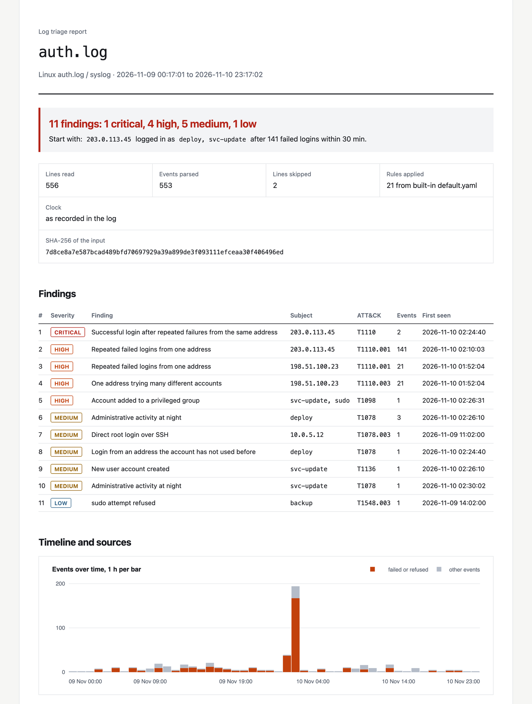
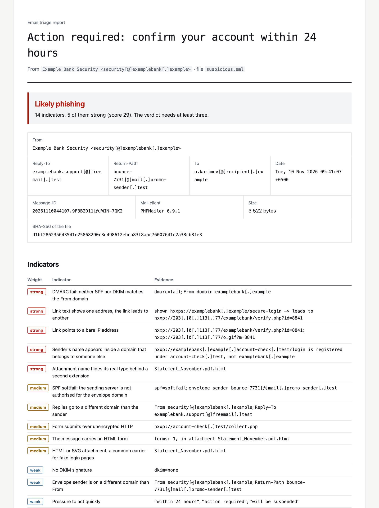

# soc-triage

First-pass triage for the two things a first-line analyst receives every day: a log file and a suspicious email.
One command reads the file, applies the checks and writes a report that can be attached to a ticket.

```
analyzer logs auth.log --out report/
analyzer eml  suspicious.eml --out report/
```

This is a personal project. It does the first, repetitive pass over one file. It is not a replacement for a SIEM,
a mail gateway or a sandbox, and a finding is a lead to verify, not a verdict.



## What it does

**Logs.** Three formats are parsed into the same six fields (time, host, user, IP, event, result):

- Linux `auth.log` / syslog: sshd, sudo, su, useradd, usermod, passwd;
- Apache and Nginx access logs in the common, combined and vhost_combined formats;
- Windows event logs exported from EVTX to CSV or JSON.

The events go through detection rules kept in one YAML file. Each rule names a MITRE ATT&CK technique, and a rule
of your own is another YAML file, with no code to change. The report lists the findings by severity, shows for each
one why the rule fired and the log lines behind it, and says what to check next.

**Email.** A saved `.eml` is read for its headers, the SPF, DKIM and DMARC results recorded by the receiving server,
the relay path, every link with the text it was shown as, and the attachments with their hashes. The message is
called phishing only when at least three independent indicators agree. Every address in the report is defanged
(`hxxp://203[.]0[.]113[.]77`, `user[@]example[.]com`).

Both commands write `report.html` (one self-contained file), `report.md`, two SVG charts and `findings.json`.
`logs` also writes `events.csv` with every normalised event; `eml` writes `iocs.csv`.

## Try it in a minute

Python 3.10 or newer. The only dependency is PyYAML.

```
git clone https://github.com/asintiko/soc-triage.git
cd soc-triage
python3 -m venv .venv
. .venv/bin/activate          # Windows: .venv\Scripts\activate
pip install -e .
analyzer logs demo/auth.log --out out/auth
```

The terminal shows:

```
auth.log: Linux auth.log / syslog
  556 lines read, 553 events parsed, 2 skipped
  11 findings: 1 critical, 4 high, 5 medium, 1 low
    critical T1110      203.0.113.45 logged in as deploy, svc-update after 141 failed logins within 30 min
    high     T1110.001  141 failed logins from 203.0.113.45, up to 55 within 5 min; accounts: deploy, root
    high     T1110.001  21 failed logins from 198.51.100.23, up to 20 within 5 min; accounts: admin, alice, deploy, ftpuser, git and 6 more
    high     T1110.003  198.51.100.23 tried 11 different accounts, up to 11 within 10 min: admin, alice, deploy, ftpuser, git and 6 more
    high     T1098      svc-update was added to the group sudo
    medium   T1078      Privileged actions by deploy between 00:00 and 05:59: 3
    medium   T1078.003  Direct root logins from 10.0.5.12: 1
    medium   T1078      deploy logged in from 203.0.113.45; earlier logins came from 10.0.5.20
    ... and 3 more in the report
  report: out/auth/report.html
```

Open `out/auth/report.html`. The same report is committed in [demo/reports/auth](demo/reports/auth/report.md), and
a test fails if a fresh run ever differs from it by a byte.

The other demo files:

| Command | What is in the file | Report |
| --- | --- | --- |
| `analyzer logs demo/auth.log` | Two days of a Linux server: an address sprays account names, another guesses a password, gets in and creates an account with sudo rights | [auth](demo/reports/auth/report.md) |
| `analyzer logs demo/access.log` | One day of a web shop: a wordlist scan that finds a backup archive, injection payloads, password guessing on the login form, a backend outage | [access](demo/reports/access/report.md) |
| `analyzer logs demo/windows-security.json --tz-offset +05:00` | A workstation: failed network logons, then a logon, an encoded PowerShell command, a new administrator, a service, a cleared log | [windows](demo/reports/windows/report.md) |
| `analyzer eml demo/suspicious.eml` | A message that claims to be from a bank and leads to a bare IP address | [suspicious-email](demo/reports/suspicious-email/report.md) |

The demo files are synthetic. `demo/generate.py` writes them with fixed seeds. Hosts, people and the bank are
invented, public addresses come from the ranges reserved for documentation (RFC 5737) and domains from the names
reserved for examples and tests (RFC 2606). Each file also carries a few broken lines to show that they are
skipped and counted, not fatal.

## Log formats

The format is detected from the content; `--format linux|web|windows` forces it.

| Format | Accepted | Notes |
| --- | --- | --- |
| Linux | `auth.log`, `secure`, syslog lines with an ISO 8601 or a classic `Nov 10 02:10:01` timestamp | Classic timestamps carry no year: pass `--year`, otherwise the current year is used |
| Web | common, combined and vhost_combined access logs | The request target is percent-decoded once before the rules see it |
| Windows | flat CSV or JSON with one column or key per event field; `evtx_dump` JSON and JSON lines; EvtxECmd CSV and JSON; `Get-WinEvent` and Event Viewer exports where the fields exist only in the message text | Message text is understood in English only. UTF-16 files from Windows PowerShell are read as they are |

A flat export with named fields gives the best result. One way to produce it on Windows:

```powershell
Get-WinEvent -Path .\Security.evtx | ForEach-Object {
    $xml = [xml]$_.ToXml()
    $row = [ordered]@{
        TimeCreated = $_.TimeCreated.ToUniversalTime().ToString('o')
        EventID     = $_.Id
        Computer    = $_.MachineName
        Channel     = $_.LogName
        Provider    = $_.ProviderName
    }
    foreach ($d in $xml.Event.EventData.Data) { if ($d.Name) { $row[$d.Name] = $d.'#text' } }
    foreach ($d in $xml.Event.UserData.ChildNodes.ChildNodes) { $row[$d.LocalName] = $d.InnerText }
    [pscustomobject]$row
} | ConvertTo-Json -Depth 3 | Set-Content security.json -Encoding utf8
```

That export is in UTC. `--tz-offset +05:00` shows such timestamps in local time, which matters for the rule about
night-time activity. Timestamps that carry no offset are used as written.

## Rules

`analyzer rules` lists the rules in use:

```
21 rules from built-in default.yaml
  critical T1110      auth-success-after-failures    Successful login after repeated failures from the same address
  high     T1110.001  auth-password-guessing         Repeated failed logins from one address
  high     T1110.003  auth-password-spraying         One address trying many different accounts
  medium   T1078      auth-new-source-for-user       Login from an address the account has not used before
  medium   T1078.003  auth-root-login                Direct root login over SSH
  medium   T1078      admin-night-activity           Administrative activity at night
  low      T1548.003  sudo-denied                    sudo attempt refused
  medium   T1136      account-created                New user account created
  high     T1098      privileged-group-change        Account added to a privileged group
  medium   T1543.003  win-service-installed          New Windows service installed
  medium   T1053.005  win-scheduled-task-created     Scheduled task created
  high     T1059.001  win-encoded-powershell         PowerShell started with an encoded or download command
  high     T1070.001  win-audit-log-cleared          Windows event log cleared
  critical T1552.001  web-secret-file-served         Secret or backup file was served to a client
  high     T1190      web-injection-attempt          Injection or path traversal pattern in a request
  medium   T1595.003  web-sensitive-path-probe       Probing for admin panels and secret files
  medium   T1595.003  web-not-found-burst            Burst of 404 responses to one client
  low      T1595.002  web-scanner-user-agent         Request from a known scanning tool
  high     T1110.001  web-login-bruteforce           Repeated refused logins on a web form
  high     T1110      web-login-after-refusals       Login form accepted a client after repeated refusals
  medium   T1190      web-server-error-burst         Burst of HTTP 5xx responses
```

The built-in file is [src/soc_triage/rules/default.yaml](src/soc_triage/rules/default.yaml). The thresholds in it
are starting values, not tuned for any particular network.

### Adding a rule

Write a YAML file and pass it with `--extra-rules`. `--rules` replaces the built-in set instead of adding to it.

```yaml
lists:
  payroll_hosts: [fin-01, fin-02]

rules:
  - id: payroll-login-on-weekend
    title: Login to a payroll host on a weekend
    severity: medium
    mitre: {id: T1078, name: Valid Accounts, tactic: Initial Access}
    description: Nobody works with payroll on weekends.
    response: Ask the account owner.
    match:
      event: login
      result: success
      host: $payroll_hosts
      weekday: [sat, sun]
      ip: {not_cidr: [10.0.0.0/8]}
    group_by: user
    summary: "{user} logged in to payroll on a weekend, logins: {count}"
```

```
analyzer logs security.json --extra-rules payroll.yaml
analyzer rules --extra-rules payroll.yaml      # checks the file and lists everything in use
```

A rule fires on the events that satisfy `match`. One optional key changes when it fires:

| Key | Fires when |
| --- | --- |
| *(none)* | on every matching event |
| `threshold: {count: 10, window: 5m}` | N matching events fall inside the window |
| `distinct: {field: user, count: 6, window: 10m}` | N different values of a field fall inside the window |
| `first_seen: {field: ip, min_history: 3}` | a value appears that the group has not had before |
| `preceded_by: {match: {...}, count: 5, window: 30m}` | a matching event follows N other events |

`group_by` evaluates the rule separately for each value of the listed fields. Conditions on a field are a value,
a list, a `$list` name or operators: `eq`, `ne`, `in`, `not_in`, `contains`, `not_contains`, `startswith`,
`endswith`, `regex`, `not_regex`, `gt`, `gte`, `lt`, `lte`, `cidr`, `not_cidr`, `exists`. There are also
`time_of_day: {between: ["00:00", "05:59"]}`, `weekday`, `any`, `all` and `not`. The fields each source provides
are listed at the top of the built-in file. A mistake in a rule file is reported with the file and the rule name.

## Email triage



What `analyzer eml` looks at:

| Area | Checks |
| --- | --- |
| Sender | SPF, DKIM and DMARC as recorded in `Authentication-Results` (or `Received-SPF`), including the case where none of them passed; Reply-To and envelope sender on another domain; a display name that shows a different address or a well-known brand on an unrelated domain; a sender domain that is not a real internet domain; missing Message-ID |
| Disguise | invisible characters hidden inside words; letters replaced with look-alike Unicode symbols |
| Links | text that shows one address while the link leads to another; bare IP hosts; `user@host` tricks; punycode hosts; URL shorteners; the sender's name inside someone else's domain; login links on other domains; forms, including forms inside HTML attachments |
| Attachments | SHA-256, SHA-1 and MD5; double extensions; executables and scripts; disk images; macro-enabled documents; HTML and SVG; archives |
| Text | pressure to act quickly; requests to confirm an account or enter credentials (English and Russian phrases) |

Each indicator has a weight: strong 3, medium 2, weak 1. The verdict is "Likely phishing" only with at least three
indicators, one of them strong, and a score of 6 or more. Anything less is "Suspicious, needs a manual look" or
"No phishing indicators found", and the report says which signs the verdict rests on.

## Checked on real mail

The checks were run on 60 real messages from [Phishing Pot](https://github.com/rf-peixoto/phishing_pot)
(commit `78be141`), a collection of phishing and spam received by honeypot addresses, maintained by
[rf-peixoto](https://www.linkedin.com/in/rf-peixoto) and licensed CC BY-NC 4.0. The samples are not part of this
repository.

| | Likely phishing | Suspicious | Not flagged |
| --- | --- | --- | --- |
| First run | 9 | 30 | 21 |
| After the fixes below | 16 | 31 | 13 |

The first run showed real gaps: the Microsoft form of `Authentication-Results` was read wrongly, sender addresses
with commas or quotes were lost, and nothing looked for invisible characters or look-alike letters. Those were
fixed and covered with tests on synthetic messages. The second row is measured on the same 60 messages the fixes
were made from, so it is not an independent estimate.

The 13 that are still not flagged pass SPF, DKIM and DMARC and use no technical trick: casino, prize and payout
offers sent from the senders' own domains. The tool does not judge what a message offers.

## What the reports are safe against

The input is written by someone else, possibly an attacker, so nothing from it is treated as markup:

- in HTML every value is escaped; the page has no scripts, no links and loads nothing from the network;
- in Markdown every value from the input sits in a code span or a fenced block, so a log line cannot become an
  image or a link when the report is pasted into a ticket;
- CSV cells that start like a formula are prefixed with an apostrophe;
- the email body is never rendered, attachments are hashed and never opened, and no DNS or HTTP request is made.

## Limits

- One file at a time. Nothing is correlated across files or hosts.
- History for "new address" starts with the file: an address from before its first line looks new.
- SPF, DKIM and DMARC are read from the headers, not verified again. Headers below the receiving server's own can
  be forged.
- Mail that passes every authentication check and uses no technical trick is not flagged, whatever it offers.
- The registrable domain is worked out from a short built-in list of two-label suffixes, not the full Public
  Suffix List.
- Windows message text is parsed in English only; exports with named fields work in any language.
- Web login guessing is recognised by 401, 403 and 429. An application that answers 200 to a wrong password needs
  its own rule.

## Tests

```
pip install -e ".[dev]"
pytest
```

75 tests cover the three parsers, including broken lines, every way a rule can fire, rule file
validation, the `.eml` checks and the verdict, defanging, and the safety of the HTML, Markdown and CSV output.
One of them compares a fresh run on the demo files with the reports committed in `demo/reports`. CI runs the suite
on Linux and Windows.

## Layout

```
src/soc_triage/
  parsers/      linux_auth.py, web_access.py, windows.py
  rules/        engine.py, default.yaml
  phishing/     parse.py, checks.py
  report/       logs.py, eml.py, html.py, markdown.py, charts.py
  defang.py, timeutil.py, model.py, cli.py
demo/           inputs, generate.py, reports/
tests/
```

## Кратко по-русски

Инструмент делает первый, одинаковый каждый день проход аналитика первой линии: разбирает файл лога
(Linux auth.log, access.log Apache/Nginx, экспорт Windows EVTX в CSV или JSON) или сохранённое письмо `.eml` и
выдаёт отчёт в HTML и Markdown, который можно приложить к тикету.

- Логи приводятся к единым полям: время, хост, пользователь, IP, событие, результат.
- Правила лежат в YAML, каждое размечено техникой MITRE ATT&CK; своё правило добавляется отдельным файлом без
  изменения кода.
- Для письма: заголовки, результаты SPF/DKIM/DMARC, все ссылки и домены, хэши вложений, таблица IOC. Вердикт
  «фишинг» ставится только при трёх и более независимых признаках. Все адреса в отчёте обезврежены.
- Демо-данные синтетические, запуск на них занимает минуту и даёт тот же отчёт, что лежит в репозитории.

Это первичная сортировка, а не замена SIEM.

## License

MIT
