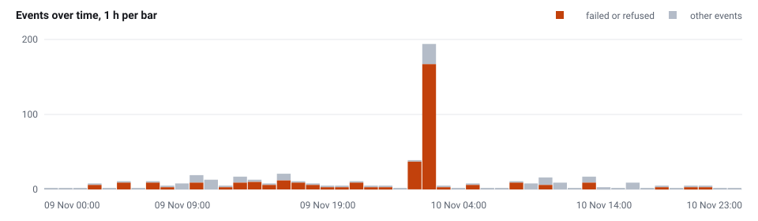
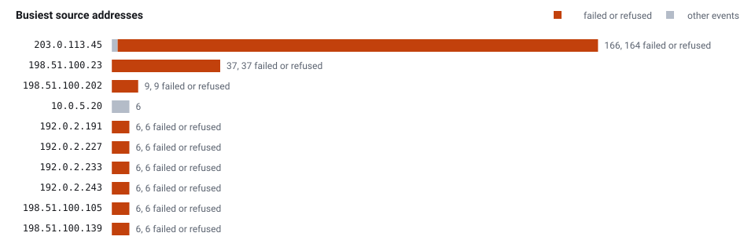

# `auth.log`

*Log triage report*

Linux auth.log / syslog · 2026-11-09 00:17:01 to 2026-11-10 23:17:02

> **11 findings: 1 critical, 4 high, 5 medium, 1 low**
>
> Start with: `203.0.113.45` logged in as `deploy, svc-update` after 141 failed logins within 30 min.

- **Lines read:** 556
- **Events parsed:** 553
- **Lines skipped:** 2
- **Rules applied:** 21 from built-in default.yaml
- **Clock:** as recorded in the log
- **SHA-256 of the input:** `7d8ce8a7e587bcad489bfd70697929a39a899de3f093111efceaa30f406496ed`

## Findings

| \# | Severity | Finding | Subject | ATT&CK | Events | First seen |
| --- | --- | --- | --- | --- | --- | --- |
| 1 | **CRITICAL** | Successful login after repeated failures from the same address | `203.0.113.45` | `T1110` | 2 | 2026-11-10 02:24:40 |
| 2 | **HIGH** | Repeated failed logins from one address | `203.0.113.45` | `T1110.001` | 141 | 2026-11-10 02:10:03 |
| 3 | **HIGH** | Repeated failed logins from one address | `198.51.100.23` | `T1110.001` | 21 | 2026-11-10 01:52:04 |
| 4 | **HIGH** | One address trying many different accounts | `198.51.100.23` | `T1110.003` | 21 | 2026-11-10 01:52:04 |
| 5 | **HIGH** | Account added to a privileged group | `svc-update, sudo` | `T1098` | 1 | 2026-11-10 02:26:31 |
| 6 | **MEDIUM** | Administrative activity at night | `deploy` | `T1078` | 3 | 2026-11-10 02:26:10 |
| 7 | **MEDIUM** | Direct root login over SSH | `10.0.5.12` | `T1078.003` | 1 | 2026-11-09 11:02:00 |
| 8 | **MEDIUM** | Login from an address the account has not used before | `deploy` | `T1078` | 1 | 2026-11-10 02:24:40 |
| 9 | **MEDIUM** | New user account created | `svc-update` | `T1136` | 1 | 2026-11-10 02:26:10 |
| 10 | **MEDIUM** | Administrative activity at night | `svc-update` | `T1078` | 1 | 2026-11-10 02:30:02 |
| 11 | **LOW** | sudo attempt refused | `backup` | `T1548.003` | 1 | 2026-11-09 14:02:00 |

## Timeline and sources





## Details

### 1. Successful login after repeated failures from the same address

**CRITICAL** · `T1110` Brute Force · Credential Access · 2 events · 2026-11-10 02:24:40 to 2026-11-10 02:29:15

**What was seen.** `203.0.113.45` logged in as `deploy, svc-update` after 141 failed logins within 30 min

An address that had just failed to log in several times then logged in successfully. If the failures were password guessing, the guess worked.

**Why it fired.** `event = login and result = success and ip is recorded`; a matching event preceded within 30 min by at least 5 events per ip where event = login and result = failure.

Evidence

| Line | Time | Host | User | IP | Event | Result |
| --- | --- | --- | --- | --- | --- | --- |
| 406 | 2026-11-10 02:23:44 | `web-01` | `root` | `203.0.113.45` | `login` | `failure` |
| 407 | 2026-11-10 02:23:48 | `web-01` | `deploy` | `203.0.113.45` | `login` | `failure` |
| 408 | 2026-11-10 02:24:40 | `web-01` | `deploy` | `203.0.113.45` | `login` | `success` |
| 425 | 2026-11-10 02:29:15 | `web-01` | `svc-update` | `203.0.113.45` | `login` | `success` |

Raw lines:

```text
406: 2026-11-10T02:23:44.666551+05:00 web-01 sshd[7299]: Failed password for root from 203.0.113.45 port 33379 ssh2
407: 2026-11-10T02:23:48.514322+05:00 web-01 sshd[7305]: Failed password for deploy from 203.0.113.45 port 57978 ssh2
408: 2026-11-10T02:24:40.623178+05:00 web-01 sshd[7314]: Accepted password for deploy from 203.0.113.45 port 54538 ssh2
425: 2026-11-10T02:29:15.392504+05:00 web-01 sshd[7399]: Accepted password for svc-update from 203.0.113.45 port 41077 ssh2
```

**What to check.** Treat the account as compromised until shown otherwise: confirm with its owner, review what the session did after this login, reset the password and revoke its keys and sessions.

Rule auth-success-after-failures from built-in default.yaml. Technique: https://attack.mitre.org/techniques/T1110/

### 2. Repeated failed logins from one address

**HIGH** · `T1110.001` Brute Force: Password Guessing · Credential Access · 141 events · 2026-11-10 02:10:03 to 2026-11-10 02:23:48

**What was seen.** 141 failed logins from `203.0.113.45`, up to 55 within 5 min; accounts: `deploy, root`

One address produced many failed logins in a short time, the pattern of an automated password-guessing run.

**Why it fired.** `event = login and result = failure and ip is recorded`; at least 10 matching events within 5 min per ip.

Evidence: 5 of 141 matching events

| Line | Time | Host | User | IP | Event | Result |
| --- | --- | --- | --- | --- | --- | --- |
| 242 | 2026-11-10 02:10:03 | `web-01` | `deploy` | `203.0.113.45` | `login` | `failure` |
| 243 | 2026-11-10 02:10:09 | `web-01` | `deploy` | `203.0.113.45` | `login` | `failure` |
| 244 | 2026-11-10 02:10:13 | `web-01` | `deploy` | `203.0.113.45` | `login` | `failure` |
| 245 | 2026-11-10 02:10:19 | `web-01` | `deploy` | `203.0.113.45` | `login` | `failure` |
| 246 | 2026-11-10 02:10:23 | `web-01` | `root` | `203.0.113.45` | `login` | `failure` |

Raw lines:

```text
242: 2026-11-10T02:10:03.130104+05:00 web-01 sshd[4354]: Failed password for deploy from 203.0.113.45 port 52477 ssh2
243: 2026-11-10T02:10:09.667812+05:00 web-01 sshd[4390]: Failed password for deploy from 203.0.113.45 port 53289 ssh2
244: 2026-11-10T02:10:13.437588+05:00 web-01 sshd[4408]: Failed password for deploy from 203.0.113.45 port 43292 ssh2
245: 2026-11-10T02:10:19.942076+05:00 web-01 sshd[4411]: Failed password for deploy from 203.0.113.45 port 35937 ssh2
246: 2026-11-10T02:10:23.799766+05:00 web-01 sshd[4435]: Failed password for root from 203.0.113.45 port 54358 ssh2
```

**What to check.** Check whether any login from this address succeeded. Block the address and make sure the targeted accounts cannot be reached with a password alone.

Rule auth-password-guessing from built-in default.yaml. Technique: https://attack.mitre.org/techniques/T1110/001/

### 3. Repeated failed logins from one address

**HIGH** · `T1110.001` Brute Force: Password Guessing · Credential Access · 21 events · 2026-11-10 01:52:04 to 2026-11-10 01:57:21

**What was seen.** 21 failed logins from `198.51.100.23`, up to 20 within 5 min; accounts: `admin, alice, deploy, ftpuser, git and 6 more`

One address produced many failed logins in a short time, the pattern of an automated password-guessing run.

**Why it fired.** `event = login and result = failure and ip is recorded`; at least 10 matching events within 5 min per ip.

Evidence: 5 of 21 matching events

| Line | Time | Host | User | IP | Event | Result |
| --- | --- | --- | --- | --- | --- | --- |
| 206 | 2026-11-10 01:52:04 | `web-01` | `admin` | `198.51.100.23` | `login` | `failure` |
| 208 | 2026-11-10 01:52:21 | `web-01` | `admin` | `198.51.100.23` | `login` | `failure` |
| 210 | 2026-11-10 01:52:38 | `web-01` | `test` | `198.51.100.23` | `login` | `failure` |
| 212 | 2026-11-10 01:52:53 | `web-01` | `test` | `198.51.100.23` | `login` | `failure` |
| 214 | 2026-11-10 01:53:15 | `web-01` | `oracle` | `198.51.100.23` | `login` | `failure` |

Raw lines:

```text
206: 2026-11-10T01:52:04.135688+05:00 web-01 sshd[3859]: Failed password for invalid user admin from 198.51.100.23 port 53888 ssh2
208: 2026-11-10T01:52:21.414774+05:00 web-01 sshd[3875]: Failed password for invalid user admin from 198.51.100.23 port 52966 ssh2
210: 2026-11-10T01:52:38.957275+05:00 web-01 sshd[3912]: Failed password for invalid user test from 198.51.100.23 port 50404 ssh2
212: 2026-11-10T01:52:53.728299+05:00 web-01 sshd[3931]: Failed password for invalid user test from 198.51.100.23 port 44159 ssh2
214: 2026-11-10T01:53:15.255348+05:00 web-01 sshd[3945]: Failed password for invalid user oracle from 198.51.100.23 port 49436 ssh2
```

**What to check.** Check whether any login from this address succeeded. Block the address and make sure the targeted accounts cannot be reached with a password alone.

Rule auth-password-guessing from built-in default.yaml. Technique: https://attack.mitre.org/techniques/T1110/001/

### 4. One address trying many different accounts

**HIGH** · `T1110.003` Brute Force: Password Spraying · Credential Access · 21 events · 2026-11-10 01:52:04 to 2026-11-10 01:57:21

**What was seen.** `198.51.100.23` tried 11 different accounts, up to 11 within 10 min: `admin, alice, deploy, ftpuser, git and 6 more`

One address failed to log in to many different accounts within a short time. Trying a few passwords across many accounts avoids lockouts.

**Why it fired.** `event = login and result = failure and ip is recorded and user is recorded`; at least 6 different values of user within 10 min per ip.

Evidence: 5 of 21 matching events

| Line | Time | Host | User | IP | Event | Result |
| --- | --- | --- | --- | --- | --- | --- |
| 206 | 2026-11-10 01:52:04 | `web-01` | `admin` | `198.51.100.23` | `login` | `failure` |
| 210 | 2026-11-10 01:52:38 | `web-01` | `test` | `198.51.100.23` | `login` | `failure` |
| 214 | 2026-11-10 01:53:15 | `web-01` | `oracle` | `198.51.100.23` | `login` | `failure` |
| 218 | 2026-11-10 01:53:39 | `web-01` | `postgres` | `198.51.100.23` | `login` | `failure` |
| 222 | 2026-11-10 01:54:04 | `web-01` | `ubuntu` | `198.51.100.23` | `login` | `failure` |

Raw lines:

```text
206: 2026-11-10T01:52:04.135688+05:00 web-01 sshd[3859]: Failed password for invalid user admin from 198.51.100.23 port 53888 ssh2
210: 2026-11-10T01:52:38.957275+05:00 web-01 sshd[3912]: Failed password for invalid user test from 198.51.100.23 port 50404 ssh2
214: 2026-11-10T01:53:15.255348+05:00 web-01 sshd[3945]: Failed password for invalid user oracle from 198.51.100.23 port 49436 ssh2
218: 2026-11-10T01:53:39.703692+05:00 web-01 sshd[4000]: Failed password for invalid user postgres from 198.51.100.23 port 36865 ssh2
222: 2026-11-10T01:54:04.774743+05:00 web-01 sshd[4039]: Failed password for invalid user ubuntu from 198.51.100.23 port 58970 ssh2
```

**What to check.** List the accounts that were tried and check each for a later successful login from an unfamiliar address.

Rule auth-password-spraying from built-in default.yaml. Technique: https://attack.mitre.org/techniques/T1110/003/

### 5. Account added to a privileged group

**HIGH** · `T1098` Account Manipulation · Privilege Escalation · 1 event · 2026-11-10 02:26:31 to 2026-11-10 02:26:31

**What was seen.** `svc-update` was added to the group `sudo`

An account was added to a group that grants administrative rights.

**Why it fired.** `event = group_member_added and group in [sudo, wheel, adm, root, admin, docker, … (13 in total)]`; every matching event per user, group.

Evidence

| Line | Time | Host | User | IP | Event | Result | Group |
| --- | --- | --- | --- | --- | --- | --- | --- |
| 416 | 2026-11-10 02:26:31 | `web-01` | `svc-update` | — | `group_member_added` | `success` | `sudo` |

Raw lines:

```text
416: 2026-11-10T02:26:31.500000+05:00 web-01 usermod[7363]: add 'svc-update' to group 'sudo'
```

**What to check.** Confirm the change with whoever owns access to that group and remove the membership if nobody asked for it.

Rule privileged-group-change from built-in default.yaml. Technique: https://attack.mitre.org/techniques/T1098/

### 6. Administrative activity at night

**MEDIUM** · `T1078` Valid Accounts · Privilege Escalation · 3 events · 2026-11-10 02:26:10 to 2026-11-10 02:27:02

**What was seen.** Privileged actions by `deploy` between 00:00 and 05:59: 3

Privileged commands or administrator logins between 00:00 and 05:59. Change the hours to match your working day.

**Why it fired.** `time of day between 00:00 and 05:59 and (event in [sudo, su] and result = success or event = login and result = success and user in [root, admin, administrator, Администратор] or event = special_privileges and user is recorded and user not in [SYSTEM, LOCAL SERVICE, NETWORK SERVICE, ANONYMOUS LOGON] and user does not match /\$$|^(DWM|UMFD)-\d+$/)`; every matching event per user.

Evidence

| Line | Time | Host | User | IP | Event | Result | Command |
| --- | --- | --- | --- | --- | --- | --- | --- |
| 413 | 2026-11-10 02:26:10 | `web-01` | `deploy` | — | `sudo` | `success` | `/usr/sbin/useradd -m -s /bin/bash svc-update` |
| 418 | 2026-11-10 02:26:31 | `web-01` | `deploy` | — | `sudo` | `success` | `/usr/sbin/usermod -aG sudo svc-update` |
| 421 | 2026-11-10 02:27:02 | `web-01` | `deploy` | — | `sudo` | `success` | `/usr/bin/passwd svc-update` |

Raw lines:

```text
413: 2026-11-10T02:26:10.806124+05:00 web-01 sudo:   deploy : TTY=pts/1 ; PWD=/home/deploy ; USER=root ; COMMAND=/usr/sbin/useradd -m -s /bin/bash svc-update
418: 2026-11-10T02:26:31.789671+05:00 web-01 sudo:   deploy : TTY=pts/1 ; PWD=/home/deploy ; USER=root ; COMMAND=/usr/sbin/usermod -aG sudo svc-update
421: 2026-11-10T02:27:02.211574+05:00 web-01 sudo:   deploy : TTY=pts/1 ; PWD=/home/deploy ; USER=root ; COMMAND=/usr/bin/passwd svc-update
```

**What to check.** Match the activity to a change ticket or an on-call shift. Without one, review every command the account ran in that session.

Rule admin-night-activity from built-in default.yaml. Technique: https://attack.mitre.org/techniques/T1078/

### 7. Direct root login over SSH

**MEDIUM** · `T1078.003` Valid Accounts: Local Accounts · Initial Access · 1 event · 2026-11-09 11:02:00 to 2026-11-09 11:02:00

**What was seen.** Direct root logins from `10.0.5.12`: 1

Someone logged in as root directly instead of through a personal account and sudo, which leaves no record of who it was.

**Why it fired.** `source = linux_auth and event = login and result = success and user = root`; every matching event per ip.

Evidence

| Line | Time | Host | User | IP | Event | Result |
| --- | --- | --- | --- | --- | --- | --- |
| 73 | 2026-11-09 11:02:00 | `web-01` | `root` | `10.0.5.12` | `login` | `success` |

Raw lines:

```text
73: 2026-11-09T11:02:00.990315+05:00 web-01 sshd[2734]: Accepted publickey for root from 10.0.5.12 port 47893 ssh2: ED25519 SHA256:rrso9g+pgE+RC9ug7ZvjzmbG0Im9Lp+oruXJWgxNbD7
```

**What to check.** Confirm the login was expected, then set PermitRootLogin to no or prohibit-password.

Rule auth-root-login from built-in default.yaml. Technique: https://attack.mitre.org/techniques/T1078/003/

### 8. Login from an address the account has not used before

**MEDIUM** · `T1078` Valid Accounts · Initial Access · 1 event · 2026-11-10 02:24:40 to 2026-11-10 02:24:40

**What was seen.** `deploy` logged in from `203.0.113.45`; earlier logins came from `10.0.5.20`

An account with an established login history logged in from an address that does not appear earlier in this log.

**Why it fired.** `event = login and result = success and ip is recorded and user is recorded and user does not match /\$$/`; a value of ip not seen before per user, after at least 3 earlier matching events.

Evidence

| Line | Time | Host | User | IP | Event | Result |
| --- | --- | --- | --- | --- | --- | --- |
| 408 | 2026-11-10 02:24:40 | `web-01` | `deploy` | `203.0.113.45` | `login` | `success` |

Raw lines:

```text
408: 2026-11-10T02:24:40.623178+05:00 web-01 sshd[7314]: Accepted password for deploy from 203.0.113.45 port 54538 ssh2
```

**What to check.** Ask the account owner whether the login was theirs. The history only covers this file, so an address from before the file starts looks new.

Rule auth-new-source-for-user from built-in default.yaml. Technique: https://attack.mitre.org/techniques/T1078/

### 9. New user account created

**MEDIUM** · `T1136` Create Account · Persistence · 1 event · 2026-11-10 02:26:10 to 2026-11-10 02:26:10

**What was seen.** Account `svc-update` was created

A user account was created. Attackers add accounts to keep access after the original entry point is closed.

**Why it fired.** `event = account_created`; every matching event per user.

Evidence

| Line | Time | Host | User | IP | Event | Result |
| --- | --- | --- | --- | --- | --- | --- |
| 412 | 2026-11-10 02:26:10 | `web-01` | `svc-update` | — | `account_created` | `success` |

Raw lines:

```text
412: 2026-11-10T02:26:10.640000+05:00 web-01 useradd[7329]: new user: name=svc-update, UID=1004, GID=1004, home=/home/svc-update, shell=/bin/bash, from=/dev/pts/1
```

**What to check.** Match the account to a request. Check who created it and what else that session did before and after.

Rule account-created from built-in default.yaml. Technique: https://attack.mitre.org/techniques/T1136/

### 10. Administrative activity at night

**MEDIUM** · `T1078` Valid Accounts · Privilege Escalation · 1 event · 2026-11-10 02:30:02 to 2026-11-10 02:30:02

**What was seen.** Privileged actions by `svc-update` between 00:00 and 05:59: 1

Privileged commands or administrator logins between 00:00 and 05:59. Change the hours to match your working day.

**Why it fired.** `time of day between 00:00 and 05:59 and (event in [sudo, su] and result = success or event = login and result = success and user in [root, admin, administrator, Администратор] or event = special_privileges and user is recorded and user not in [SYSTEM, LOCAL SERVICE, NETWORK SERVICE, ANONYMOUS LOGON] and user does not match /\$$|^(DWM|UMFD)-\d+$/)`; every matching event per user.

Evidence

| Line | Time | Host | User | IP | Event | Result | Command |
| --- | --- | --- | --- | --- | --- | --- | --- |
| 428 | 2026-11-10 02:30:02 | `web-01` | `svc-update` | — | `sudo` | `success` | `/usr/bin/crontab -l` |

Raw lines:

```text
428: 2026-11-10T02:30:02.210112+05:00 web-01 sudo:   svc-update : TTY=pts/2 ; PWD=/home/svc-update ; USER=root ; COMMAND=/usr/bin/crontab -l
```

**What to check.** Match the activity to a change ticket or an on-call shift. Without one, review every command the account ran in that session.

Rule admin-night-activity from built-in default.yaml. Technique: https://attack.mitre.org/techniques/T1078/

### 11. sudo attempt refused

**LOW** · `T1548.003` Abuse Elevation Control Mechanism: Sudo and Sudo Caching · Privilege Escalation · 1 event · 2026-11-09 14:02:00 to 2026-11-09 14:02:00

**What was seen.** sudo or su refused for `backup`, attempts: 1; command: `/usr/bin/cat /etc/shadow`

sudo refused a command: the user is not in sudoers, typed a wrong password or asked for a command they are not allowed to run.

**Why it fired.** `event in [sudo, su] and result = failure`; every matching event per user.

Evidence

| Line | Time | Host | User | IP | Event | Result | Command |
| --- | --- | --- | --- | --- | --- | --- | --- |
| 108 | 2026-11-09 14:02:00 | `web-01` | `backup` | — | `sudo` | `failure` | `/usr/bin/cat /etc/shadow` |

Raw lines:

```text
108: 2026-11-09T14:02:00.220855+05:00 web-01 sudo:   backup : user NOT in sudoers ; TTY=pts/2 ; PWD=/var/backups ; USER=root ; COMMAND=/usr/bin/cat /etc/shadow
```

**What to check.** A single refusal is usually a mistake. Several from one account, or from a service account, deserve a question to its owner.

Rule sudo-denied from built-in default.yaml. Technique: https://attack.mitre.org/techniques/T1548/003/

## Events by type

| Event | Result | Count |
| --- | --- | --- |
| `login` | `failure` | 214 |
| `preauth_disconnect` | `failure` | 75 |
| `session_closed` | — | 75 |
| `session_opened` | — | 75 |
| `invalid_user` | `failure` | 68 |
| `other` | — | 15 |
| `sudo` | `success` | 14 |
| `login` | `success` | 13 |
| `account_created` | `success` | 1 |
| `group_member_added` | `success` | 1 |
| `password_changed` | `success` | 1 |
| `sudo` | `failure` | 1 |

Every parsed event with its normalised fields is in events.csv.

## Skipped lines

2 lines could not be read and were left out of the analysis.

| Line | Reason | Text |
| --- | --- | --- |
| 141 | not a syslog line | `2026-11-09T11:4` |
| 521 | not a syslog line | `tail: /var/log/auth.log: file truncated` |

## Rules applied

| Rule | Severity | ATT&CK | Title | Findings |
| --- | --- | --- | --- | --- |
| `auth-success-after-failures` | **CRITICAL** | `T1110` | Successful login after repeated failures from the same address | 1 |
| `auth-password-guessing` | **HIGH** | `T1110.001` | Repeated failed logins from one address | 2 |
| `auth-password-spraying` | **HIGH** | `T1110.003` | One address trying many different accounts | 1 |
| `auth-new-source-for-user` | **MEDIUM** | `T1078` | Login from an address the account has not used before | 1 |
| `auth-root-login` | **MEDIUM** | `T1078.003` | Direct root login over SSH | 1 |
| `admin-night-activity` | **MEDIUM** | `T1078` | Administrative activity at night | 2 |
| `sudo-denied` | **LOW** | `T1548.003` | sudo attempt refused | 1 |
| `account-created` | **MEDIUM** | `T1136` | New user account created | 1 |
| `privileged-group-change` | **HIGH** | `T1098` | Account added to a privileged group | 1 |
| `win-service-installed` | **MEDIUM** | `T1543.003` | New Windows service installed | — |
| `win-scheduled-task-created` | **MEDIUM** | `T1053.005` | Scheduled task created | — |
| `win-encoded-powershell` | **HIGH** | `T1059.001` | PowerShell started with an encoded or download command | — |
| `win-audit-log-cleared` | **HIGH** | `T1070.001` | Windows event log cleared | — |
| `web-secret-file-served` | **CRITICAL** | `T1552.001` | Secret or backup file was served to a client | — |
| `web-injection-attempt` | **HIGH** | `T1190` | Injection or path traversal pattern in a request | — |
| `web-sensitive-path-probe` | **MEDIUM** | `T1595.003` | Probing for admin panels and secret files | — |
| `web-not-found-burst` | **MEDIUM** | `T1595.003` | Burst of 404 responses to one client | — |
| `web-scanner-user-agent` | **LOW** | `T1595.002` | Request from a known scanning tool | — |
| `web-login-bruteforce` | **HIGH** | `T1110.001` | Repeated refused logins on a web form | — |
| `web-login-after-refusals` | **HIGH** | `T1110` | Login form accepted a client after repeated refusals | — |
| `web-server-error-burst` | **MEDIUM** | `T1190` | Burst of HTTP 5xx responses | — |

A finding is a lead to verify, not a verdict. The report covers one file: anything outside it, and anything none of these rules describe, is not here.

---

soc-triage 0.1.0. First-pass triage of one file, not a replacement for a SIEM.
