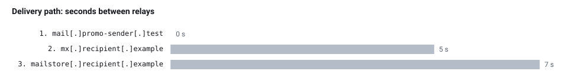
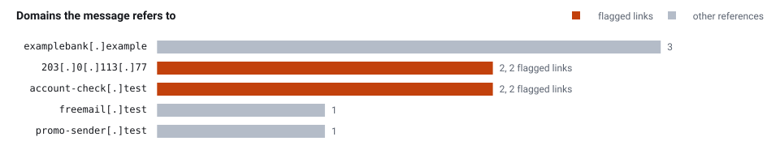

# `Action required: confirm your account within 24 hours`

*Email triage report*

From `Example Bank Security <security[@]examplebank[.]example>` · file `suspicious.eml`

> **Likely phishing**
>
> 14 indicators, 5 of them strong (score 29). The verdict needs at least three.

- **From:** `Example Bank Security <security[@]examplebank[.]example>`
- **Reply-To:** `examplebank.support[@]freemail[.]test`
- **Return-Path:** `bounce-7731[@]mail[.]promo-sender[.]test`
- **To:** `a.karimov[@]recipient[.]example`
- **Date:** `Tue, 10 Nov 2026 09:41:07 +0500`
- **Message-ID:** `20261110044107.9F3B2D11[@]WIN-7QK2`
- **Mail client:** `PHPMailer 6.9.1`
- **Size:** 3 522 bytes
- **SHA-256 of the file:** `d1bf286235643541e25868290c3d498612ebca83f8aac76007641c2a38cb8fe3`

## Indicators

| Weight | Indicator | Evidence |
| --- | --- | --- |
| **strong** | DMARC fail: neither SPF nor DKIM matches the From domain | `dmarc=fail`; `From domain examplebank[.]example` |
| **strong** | Link text shows one address, the link leads to another | `shown hxxps://examplebank[.]example/secure-login -> leads to hxxp://203[.]0[.]113[.]77/examplebank/verify.php?id=8841` |
| **strong** | Link points to a bare IP address | `hxxp://203[.]0[.]113[.]77/examplebank/verify.php?id=8841`; `hxxp://203[.]0[.]113[.]77/o.gif?m=8841` |
| **strong** | Sender's name appears inside a domain that belongs to someone else | `hxxp://examplebank[.]example[.]account-check[.]test/login is registered under account-check[.]test, not examplebank[.]example` |
| **strong** | Attachment name hides its real type behind a second extension | `Statement_November.pdf.html` |
| **medium** | SPF softfail: the sending server is not authorised for the envelope domain | `spf=softfail`; `envelope sender bounce-7731[@]mail[.]promo-sender[.]test` |
| **medium** | Replies go to a different domain than the sender | `From security[@]examplebank[.]example`; `Reply-To examplebank.support[@]freemail[.]test` |
| **medium** | Form submits over unencrypted HTTP | `hxxp://account-check[.]test/collect.php` |
| **medium** | The message carries an HTML form | `forms: 1, in attachment Statement_November.pdf.html` |
| **medium** | HTML or SVG attachment, a common carrier for fake login pages | `Statement_November.pdf.html` |
| **weak** | No DKIM signature | `dkim=none` |
| **weak** | Envelope sender is on a different domain than From | `From security[@]examplebank[.]example`; `Return-Path bounce-7731[@]mail[.]promo-sender[.]test` |
| **weak** | Pressure to act quickly | `"within 24 hours"`; `"action required"`; `"will be suspended"` |
| **weak** | Asks the reader to confirm an account or enter credentials | `"confirm your account"`; `"confirm your identity"` |

Strong counts 3, medium 2, weak 1. The message is called phishing only with at least three indicators, one of them strong, and a score of 6 or more.

## Sender authentication

As recorded by the receiving server `mx[.]recipient[.]example` in the Authentication-Results header. Nothing was checked against DNS again.

| Check | Result | Details | Source |
| --- | --- | --- | --- |
| SPF | **softfail** | `smtp.mailfrom=bounce-7731[@]mail[.]promo-sender[.]test` | Authentication-Results |
| DKIM | **none** | — | Authentication-Results |
| DMARC | **fail** | `header.from=examplebank[.]example` | Authentication-Results |

## Links (6)

| \# | URL | Shown as | Found in | Notes |
| --- | --- | --- | --- | --- |
| 1 | `hxxp://203[.]0[.]113[.]77/examplebank/verify.php?id=8841` | `hxxps://examplebank[.]example/secure-login` | `text body, HTML body, link` | Link text shows one address, the link leads to another; Link points to a bare IP address |
| 2 | `hxxp://examplebank[.]example[.]account-check[.]test/login` | `Example Bank mobile` | `HTML body, link` | Sender's name appears inside a domain that belongs to someone else |
| 3 | `hxxps://examplebank[.]example/help` | `help centre` | `HTML body, link` | — |
| 4 | `hxxp://203[.]0[.]113[.]77/o.gif?m=8841` | — | `HTML body, img source` | Link points to a bare IP address |
| 5 | `hxxps://examplebank[.]example/secure-login` | — | `HTML body, text` | — |
| 6 | `hxxp://account-check[.]test/collect.php` | — | `attachment Statement_November.pdf.html, form action` | Form submits over unencrypted HTTP |

## Attachments (1)

| File | Declared type | Size | SHA-256 | MD5 |
| --- | --- | --- | --- | --- |
| `Statement_November.pdf.html` | `text/html` | 371 bytes | `b44ce1060fff459d29ae614caca0ec1340d69fdc97127912bf3221e24a5bb670` | `66116c4e1c12106a844a94c3fef97ee4` |

Attachments were hashed, not opened or executed.

## Delivery path

Received headers, oldest first. Every relay writes its own line, and the earliest ones are written by the sender's side and can be invented.

| Hop | From | Address | By | Protocol | Time | Delay |
| --- | --- | --- | --- | --- | --- | --- |
| 1 | `WIN-7QK2` | `198[.]51[.]100[.]201` | `mail[.]promo-sender[.]test` | `ESMTPA` | 2026-11-10 04:41:07+00:00 | — |
| 2 | `mail[.]promo-sender[.]test` | `203[.]0[.]113[.]77` | `mx[.]recipient[.]example` | `ESMTPS` | 2026-11-10 09:41:12+05:00 | 5 s |
| 3 | `mx[.]recipient[.]example` | `192[.]0[.]2[.]10` | `mailstore[.]recipient[.]example` | `LMTP` | 2026-11-10 09:41:19+05:00 | 7 s |





## Indicators of compromise

| Type | Value | Seen in |
| --- | --- | --- |
| url | `hxxp://203[.]0[.]113[.]77/examplebank/verify.php?id=8841` | `text body, HTML body, link` |
| url | `hxxp://examplebank[.]example[.]account-check[.]test/login` | `HTML body, link` |
| url | `hxxps://examplebank[.]example/help` | `HTML body, link` |
| url | `hxxp://203[.]0[.]113[.]77/o.gif?m=8841` | `HTML body, img source` |
| url | `hxxps://examplebank[.]example/secure-login` | `HTML body, text` |
| url | `hxxp://account-check[.]test/collect.php` | `attachment Statement_November.pdf.html, form action` |
| ip | `203[.]0[.]113[.]77` | `link host` |
| domain | `account-check[.]test` | `link host` |
| domain | `examplebank[.]example` | `link host` |
| email | `security[@]examplebank[.]example` | `From (can be forged)` |
| email | `examplebank.support[@]freemail[.]test` | `Reply-To` |
| email | `bounce-7731[@]mail[.]promo-sender[.]test` | `Return-Path` |
| sha256 | `b44ce1060fff459d29ae614caca0ec1340d69fdc97127912bf3221e24a5bb670` | `attachment Statement_November.pdf.html` |
| md5 | `66116c4e1c12106a844a94c3fef97ee4` | `attachment Statement_November.pdf.html` |
| filename | `Statement_November.pdf.html` | `attachment` |

Addresses are defanged: hxxp instead of http, \[.\] instead of a dot, \[@\] instead of @. The same table is in iocs.csv.

## Message text

Defanged:

```text
Dear customer,

We noticed an unusual sign-in to your Example Bank account. To keep your money safe we have limited
the account. It will be suspended within 24 hours unless you confirm your identity.

Confirm here: hxxp://203[.]0[.]113[.]77/examplebank/verify.php?id=8841

Your statement for November is attached.

Example Bank
```

The verdict is a lead for the analyst, not a decision. A message with none of these signs can still be malicious, and a legitimate one can show several.

---

soc-triage 0.1.0. First-pass triage of one message, not a replacement for a mail gateway or a sandbox.
