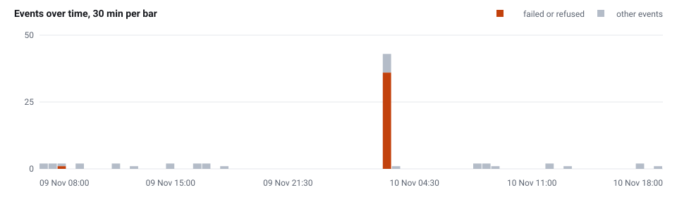
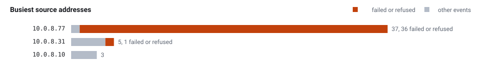

# `windows-security.json`

*Log triage report*

Windows event log export (CSV / JSON) · 2026-11-09 08:01:00 to 2026-11-10 18:03:00

> **10 findings: 1 critical, 4 high, 5 medium**
>
> Start with: `10.0.8.77` logged in as `Administrator` after 36 failed logins within 30 min.

- **Records read:** 75
- **Events parsed:** 73
- **Records skipped:** 2
- **Rules applied:** 21 from built-in default.yaml
- **Clock:** timestamps that carry an offset are shown in UTC+05:00; others as recorded
- **SHA-256 of the input:** `77f7f7148c18174a2f9a18acbb9d0a2cb7ce783aee2472adfa741368753608a9`

## Findings

| \# | Severity | Finding | Subject | ATT&CK | Events | First seen |
| --- | --- | --- | --- | --- | --- | --- |
| 1 | **CRITICAL** | Successful login after repeated failures from the same address | `10.0.8.77` | `T1110` | 1 | 2026-11-10 03:08:53 |
| 2 | **HIGH** | Repeated failed logins from one address | `10.0.8.77` | `T1110.001` | 36 | 2026-11-10 03:05:09 |
| 3 | **HIGH** | PowerShell started with an encoded or download command | `ACC-WS-07.corp.example` | `T1059.001` | 1 | 2026-11-10 03:12:30 |
| 4 | **HIGH** | Account added to a privileged group | `S-1-5-21-1004336348-1177238915-682003330-1124, Administrators` | `T1098` | 1 | 2026-11-10 03:14:40 |
| 5 | **HIGH** | Windows event log cleared | `ACC-WS-07.corp.example` | `T1070.001` | 1 | 2026-11-10 03:38:17 |
| 6 | **MEDIUM** | Administrative activity at night | `Administrator` | `T1078` | 2 | 2026-11-10 03:08:53 |
| 7 | **MEDIUM** | Login from an address the account has not used before | `Administrator` | `T1078` | 1 | 2026-11-10 03:08:53 |
| 8 | **MEDIUM** | New user account created | `helpdesk2` | `T1136` | 1 | 2026-11-10 03:14:02 |
| 9 | **MEDIUM** | New Windows service installed | `UpdaterSvc` | `T1543.003` | 1 | 2026-11-10 03:21:11 |
| 10 | **MEDIUM** | Scheduled task created | `\UpdaterSync` | `T1053.005` | 1 | 2026-11-10 03:23:48 |

## Timeline and sources





## Details

### 1. Successful login after repeated failures from the same address

**CRITICAL** · `T1110` Brute Force · Credential Access · 1 event · 2026-11-10 03:08:53 to 2026-11-10 03:08:53

**What was seen.** `10.0.8.77` logged in as `Administrator` after 36 failed logins within 30 min

An address that had just failed to log in several times then logged in successfully. If the failures were password guessing, the guess worked.

**Why it fired.** `event = login and result = success and ip is recorded`; a matching event preceded within 30 min by at least 5 events per ip where event = login and result = failure.

Evidence

| Record | Time | Host | User | IP | Event | Result |
| --- | --- | --- | --- | --- | --- | --- |
| 55 | 2026-11-10 03:08:41 | `ACC-WS-07.corp.example` | `Administrator` | `10.0.8.77` | `login` | `failure` |
| 56 | 2026-11-10 03:08:49 | `ACC-WS-07.corp.example` | `Administrator` | `10.0.8.77` | `login` | `failure` |
| 57 | 2026-11-10 03:08:53 | `ACC-WS-07.corp.example` | `Administrator` | `10.0.8.77` | `login` | `success` |

Raw records:

```text
55: {"TimeCreated":"2026-11-09T22:08:41.7236550Z","EventID":4625,"Computer":"ACC-WS-07.corp.example","Channel":"Security","Status":"0xc000006d","SubStatus":"0xc000006a","SubjectUserName":"-","TargetUserName":"Administrator","TargetDomainName":"CORP","LogonType":3,"IpAddress":"10.0.8.77","WorkstationName":"WS-GUEST-03"}
56: {"TimeCreated":"2026-11-09T22:08:49.7950430Z","EventID":4625,"Computer":"ACC-WS-07.corp.example","Channel":"Security","Status":"0xc000006d","SubStatus":"0xc000006a","SubjectUserName":"-","TargetUserName":"Administrator","TargetDomainName":"CORP","LogonType":3,"IpAddress":"10.0.8.77","WorkstationName":"WS-GUEST-03"}
57: {"TimeCreated":"2026-11-09T22:08:53.1833830Z","EventID":4624,"Computer":"ACC-WS-07.corp.example","Channel":"Security","SubjectUserName":"-","TargetUserName":"Administrator","TargetDomainName":"CORP","LogonType":3,"IpAddress":"10.0.8.77","WorkstationName":"WS-GUEST-03"}
```

**What to check.** Treat the account as compromised until shown otherwise: confirm with its owner, review what the session did after this login, reset the password and revoke its keys and sessions.

Rule auth-success-after-failures from built-in default.yaml. Technique: https://attack.mitre.org/techniques/T1110/

### 2. Repeated failed logins from one address

**HIGH** · `T1110.001` Brute Force: Password Guessing · Credential Access · 36 events · 2026-11-10 03:05:09 to 2026-11-10 03:08:49

**What was seen.** 36 failed logins from `10.0.8.77`, up to 36 within 5 min; accounts: `Administrator`

One address produced many failed logins in a short time, the pattern of an automated password-guessing run.

**Why it fired.** `event = login and result = failure and ip is recorded`; at least 10 matching events within 5 min per ip.

Evidence: 5 of 36 matching events

| Record | Time | Host | User | IP | Event | Result |
| --- | --- | --- | --- | --- | --- | --- |
| 20 | 2026-11-10 03:05:09 | `ACC-WS-07.corp.example` | `Administrator` | `10.0.8.77` | `login` | `failure` |
| 21 | 2026-11-10 03:05:14 | `ACC-WS-07.corp.example` | `Administrator` | `10.0.8.77` | `login` | `failure` |
| 22 | 2026-11-10 03:05:21 | `ACC-WS-07.corp.example` | `Administrator` | `10.0.8.77` | `login` | `failure` |
| 23 | 2026-11-10 03:05:29 | `ACC-WS-07.corp.example` | `Administrator` | `10.0.8.77` | `login` | `failure` |
| 24 | 2026-11-10 03:05:36 | `ACC-WS-07.corp.example` | `Administrator` | `10.0.8.77` | `login` | `failure` |

Raw records:

```text
20: {"TimeCreated":"2026-11-09T22:05:09.1183140Z","EventID":4625,"Computer":"ACC-WS-07.corp.example","Channel":"Security","Status":"0xc000006d","SubStatus":"0xc000006a","SubjectUserName":"-","TargetUserName":"Administrator","TargetDomainName":"CORP","LogonType":3,"IpAddress":"10.0.8.77","WorkstationName":"WS-GUEST-03"}
21: {"TimeCreated":"2026-11-09T22:05:14.8268490Z","EventID":4625,"Computer":"ACC-WS-07.corp.example","Channel":"Security","Status":"0xc000006d","SubStatus":"0xc000006a","SubjectUserName":"-","TargetUserName":"Administrator","TargetDomainName":"CORP","LogonType":3,"IpAddress":"10.0.8.77","WorkstationName":"WS-GUEST-03"}
22: {"TimeCreated":"2026-11-09T22:05:21.6103400Z","EventID":4625,"Computer":"ACC-WS-07.corp.example","Channel":"Security","Status":"0xc000006d","SubStatus":"0xc000006a","SubjectUserName":"-","TargetUserName":"Administrator","TargetDomainName":"CORP","LogonType":3,"IpAddress":"10.0.8.77","WorkstationName":"WS-GUEST-03"}
23: {"TimeCreated":"2026-11-09T22:05:29.8293450Z","EventID":4625,"Computer":"ACC-WS-07.corp.example","Channel":"Security","Status":"0xc000006d","SubStatus":"0xc000006a","SubjectUserName":"-","TargetUserName":"Administrator","TargetDomainName":"CORP","LogonType":3,"IpAddress":"10.0.8.77","WorkstationName":"WS-GUEST-03"}
24: {"TimeCreated":"2026-11-09T22:05:36.8622410Z","EventID":4625,"Computer":"ACC-WS-07.corp.example","Channel":"Security","Status":"0xc000006d","SubStatus":"0xc000006a","SubjectUserName":"-","TargetUserName":"Administrator","TargetDomainName":"CORP","LogonType":3,"IpAddress":"10.0.8.77","WorkstationName":"WS-GUEST-03"}
```

**What to check.** Check whether any login from this address succeeded. Block the address and make sure the targeted accounts cannot be reached with a password alone.

Rule auth-password-guessing from built-in default.yaml. Technique: https://attack.mitre.org/techniques/T1110/001/

### 3. PowerShell started with an encoded or download command

**HIGH** · `T1059.001` Command and Scripting Interpreter: PowerShell · Execution · 1 event · 2026-11-10 03:12:30 to 2026-11-10 03:12:30

**What was seen.** PowerShell with encoded or download content on `ACC-WS-07.corp.example`, commands: 1

PowerShell was started with a Base64-encoded command or with code that downloads and runs content. Both hide what the command does from a quick look.

**Why it fired.** `event in [process_created, powershell_script] and command matches /powershell(\.exe)?["']?\s.*[-/]e[a-z]{0,13}\s+["']?[A-Za-z0-9+/=]{40,} | frombase64stri…/`; every matching event per host.

Evidence

| Record | Time | Host | User | IP | Event | Result | Command |
| --- | --- | --- | --- | --- | --- | --- | --- |
| 59 | 2026-11-10 03:12:30 | `ACC-WS-07.corp.example` | `Administrator` | — | `process_created` | `success` | `powershell.exe -NoP -W Hidden -Enc VwByAGkAdABlAC0ATwB1AHQAcAB1AHQAIAAnAGQAZQBtAG8AOgAgAHQAaABpAHMAIABzAHQAYQBuAGQAcwAgAGkAbgAgAGYAbwByACAAYQBuACAAZQBuAGMAbwBkA` |

Raw records:

```text
59: {"TimeCreated":"2026-11-09T22:12:30.2124920Z","EventID":4688,"Computer":"ACC-WS-07.corp.example","Channel":"Security","SubjectUserName":"Administrator","SubjectDomainName":"CORP","NewProcessName":"C:\\Windows\\System32\\WindowsPowerShell\\v1.0\\powershell.exe","CommandLine":"powershell.exe -NoP -W Hidden -Enc VwByAGkAdABlAC0ATwB1AHQAcAB1AHQAIAAnAGQAZQBtAG8AOgAgAHQAaABpAHMAIABzAHQAYQBuAGQAcwAgAGkAb
```

**What to check.** Decode the command and read it. Find the parent process to see what launched it.

Rule win-encoded-powershell from built-in default.yaml. Technique: https://attack.mitre.org/techniques/T1059/001/

### 4. Account added to a privileged group

**HIGH** · `T1098` Account Manipulation · Privilege Escalation · 1 event · 2026-11-10 03:14:40 to 2026-11-10 03:14:40

**What was seen.** `S-1-5-21-1004336348-1177238915-682003330-1124` was added to the group `Administrators`

An account was added to a group that grants administrative rights.

**Why it fired.** `event = group_member_added and group in [sudo, wheel, adm, root, admin, docker, … (13 in total)]`; every matching event per user, group.

Evidence

| Record | Time | Host | User | IP | Event | Result | Group |
| --- | --- | --- | --- | --- | --- | --- | --- |
| 61 | 2026-11-10 03:14:40 | `ACC-WS-07.corp.example` | `S-1-5-21-1004336348-1177238915-682003330-1124` | — | `group_member_added` | `success` | `Administrators` |

Raw records:

```text
61: {"TimeCreated":"2026-11-09T22:14:40.0823040Z","EventID":4732,"Computer":"ACC-WS-07.corp.example","Channel":"Security","SubjectUserName":"Administrator","SubjectDomainName":"CORP","TargetUserName":"Administrators","TargetDomainName":"Builtin","MemberName":"-","MemberSid":"S-1-5-21-1004336348-1177238915-682003330-1124"}
```

**What to check.** Confirm the change with whoever owns access to that group and remove the membership if nobody asked for it.

Rule privileged-group-change from built-in default.yaml. Technique: https://attack.mitre.org/techniques/T1098/

### 5. Windows event log cleared

**HIGH** · `T1070.001` Indicator Removal: Clear Windows Event Logs · Defense Evasion · 1 event · 2026-11-10 03:38:17 to 2026-11-10 03:38:17

**What was seen.** An event log on `ACC-WS-07.corp.example` was cleared, events: 1

An event log was cleared. Outside planned maintenance this is done to remove traces.

**Why it fired.** `event = log_cleared`; every matching event per host.

Evidence

| Record | Time | Host | User | IP | Event | Result |
| --- | --- | --- | --- | --- | --- | --- |
| 64 | 2026-11-10 03:38:17 | `ACC-WS-07.corp.example` | `Administrator` | — | `log_cleared` | `success` |

Raw records:

```text
64: {"TimeCreated":"2026-11-09T22:38:17.6587930Z","EventID":1102,"Computer":"ACC-WS-07.corp.example","Channel":"Security","SubjectUserName":"Administrator","SubjectDomainName":"CORP"}
```

**What to check.** Find out who cleared it and why. Recover earlier events from a log collector or a backup if there is one.

Rule win-audit-log-cleared from built-in default.yaml. Technique: https://attack.mitre.org/techniques/T1070/001/

### 6. Administrative activity at night

**MEDIUM** · `T1078` Valid Accounts · Privilege Escalation · 2 events · 2026-11-10 03:08:53 to 2026-11-10 03:08:54

**What was seen.** Privileged actions by `Administrator` between 00:00 and 05:59: 2

Privileged commands or administrator logins between 00:00 and 05:59. Change the hours to match your working day.

**Why it fired.** `time of day between 00:00 and 05:59 and (event in [sudo, su] and result = success or event = login and result = success and user in [root, admin, administrator, Администратор] or event = special_privileges and user is recorded and user not in [SYSTEM, LOCAL SERVICE, NETWORK SERVICE, ANONYMOUS LOGON] and user does not match /\$$|^(DWM|UMFD)-\d+$/)`; every matching event per user.

Evidence

| Record | Time | Host | User | IP | Event | Result |
| --- | --- | --- | --- | --- | --- | --- |
| 57 | 2026-11-10 03:08:53 | `ACC-WS-07.corp.example` | `Administrator` | `10.0.8.77` | `login` | `success` |
| 58 | 2026-11-10 03:08:54 | `ACC-WS-07.corp.example` | `Administrator` | — | `special_privileges` | `success` |

Raw records:

```text
57: {"TimeCreated":"2026-11-09T22:08:53.1833830Z","EventID":4624,"Computer":"ACC-WS-07.corp.example","Channel":"Security","SubjectUserName":"-","TargetUserName":"Administrator","TargetDomainName":"CORP","LogonType":3,"IpAddress":"10.0.8.77","WorkstationName":"WS-GUEST-03"}
58: {"TimeCreated":"2026-11-09T22:08:54.2556860Z","EventID":4672,"Computer":"ACC-WS-07.corp.example","Channel":"Security","SubjectUserName":"Administrator","SubjectDomainName":"CORP"}
```

**What to check.** Match the activity to a change ticket or an on-call shift. Without one, review every command the account ran in that session.

Rule admin-night-activity from built-in default.yaml. Technique: https://attack.mitre.org/techniques/T1078/

### 7. Login from an address the account has not used before

**MEDIUM** · `T1078` Valid Accounts · Initial Access · 1 event · 2026-11-10 03:08:53 to 2026-11-10 03:08:53

**What was seen.** `Administrator` logged in from `10.0.8.77`; earlier logins came from `10.0.8.10`

An account with an established login history logged in from an address that does not appear earlier in this log.

**Why it fired.** `event = login and result = success and ip is recorded and user is recorded and user does not match /\$$/`; a value of ip not seen before per user, after at least 3 earlier matching events.

Evidence

| Record | Time | Host | User | IP | Event | Result |
| --- | --- | --- | --- | --- | --- | --- |
| 57 | 2026-11-10 03:08:53 | `ACC-WS-07.corp.example` | `Administrator` | `10.0.8.77` | `login` | `success` |

Raw records:

```text
57: {"TimeCreated":"2026-11-09T22:08:53.1833830Z","EventID":4624,"Computer":"ACC-WS-07.corp.example","Channel":"Security","SubjectUserName":"-","TargetUserName":"Administrator","TargetDomainName":"CORP","LogonType":3,"IpAddress":"10.0.8.77","WorkstationName":"WS-GUEST-03"}
```

**What to check.** Ask the account owner whether the login was theirs. The history only covers this file, so an address from before the file starts looks new.

Rule auth-new-source-for-user from built-in default.yaml. Technique: https://attack.mitre.org/techniques/T1078/

### 8. New user account created

**MEDIUM** · `T1136` Create Account · Persistence · 1 event · 2026-11-10 03:14:02 to 2026-11-10 03:14:02

**What was seen.** Account `helpdesk2` was created

A user account was created. Attackers add accounts to keep access after the original entry point is closed.

**Why it fired.** `event = account_created`; every matching event per user.

Evidence

| Record | Time | Host | User | IP | Event | Result |
| --- | --- | --- | --- | --- | --- | --- |
| 60 | 2026-11-10 03:14:02 | `ACC-WS-07.corp.example` | `helpdesk2` | — | `account_created` | `success` |

Raw records:

```text
60: {"TimeCreated":"2026-11-09T22:14:02.4339610Z","EventID":4720,"Computer":"ACC-WS-07.corp.example","Channel":"Security","SubjectUserName":"Administrator","SubjectDomainName":"CORP","TargetUserName":"helpdesk2","TargetDomainName":"ACC-WS-07"}
```

**What to check.** Match the account to a request. Check who created it and what else that session did before and after.

Rule account-created from built-in default.yaml. Technique: https://attack.mitre.org/techniques/T1136/

### 9. New Windows service installed

**MEDIUM** · `T1543.003` Create or Modify System Process: Windows Service · Persistence · 1 event · 2026-11-10 03:21:11 to 2026-11-10 03:21:11

**What was seen.** Service `UpdaterSvc` was installed: `C:\ProgramData\updater\upd.exe`

A service was installed. Services start with the system and usually run with SYSTEM rights, which makes them a common way to persist.

**Why it fired.** `event = service_installed`; every matching event per service.

Evidence

| Record | Time | Host | User | IP | Event | Result | Command | Service |
| --- | --- | --- | --- | --- | --- | --- | --- | --- |
| 62 | 2026-11-10 03:21:11 | `ACC-WS-07.corp.example` | — | — | `service_installed` | `success` | `C:\ProgramData\updater\upd.exe` | `UpdaterSvc` |

Raw records:

```text
62: {"TimeCreated":"2026-11-09T22:21:11.3806880Z","EventID":7045,"Computer":"ACC-WS-07.corp.example","Channel":"System","ProviderName":"Service Control Manager","ServiceName":"UpdaterSvc","ImagePath":"C:\\ProgramData\\updater\\upd.exe","ServiceType":"user mode service","StartType":"auto start","AccountName":"LocalSystem"}
```

**What to check.** Check the binary path and its signature. Paths under Temp, ProgramData or a user profile are a warning sign.

Rule win-service-installed from built-in default.yaml. Technique: https://attack.mitre.org/techniques/T1543/003/

### 10. Scheduled task created

**MEDIUM** · `T1053.005` Scheduled Task/Job: Scheduled Task · Persistence · 1 event · 2026-11-10 03:23:48 to 2026-11-10 03:23:48

**What was seen.** Scheduled task `\UpdaterSync` was created

A scheduled task was registered. Tasks are used to run a payload again after a reboot or at a set time.

**Why it fired.** `event = scheduled_task_created`; every matching event per task.

Evidence

| Record | Time | Host | User | IP | Event | Result | Task |
| --- | --- | --- | --- | --- | --- | --- | --- |
| 63 | 2026-11-10 03:23:48 | `ACC-WS-07.corp.example` | `Administrator` | — | `scheduled_task_created` | `success` | `\UpdaterSync` |

Raw records:

```text
63: {"TimeCreated":"2026-11-09T22:23:48.7552940Z","EventID":4698,"Computer":"ACC-WS-07.corp.example","Channel":"Security","SubjectUserName":"Administrator","SubjectDomainName":"CORP","TaskName":"\\UpdaterSync"}
```

**What to check.** Open the task definition and look at its action and the account it runs as.

Rule win-scheduled-task-created from built-in default.yaml. Technique: https://attack.mitre.org/techniques/T1053/005/

## Events by type

| Event | Result | Count |
| --- | --- | --- |
| `login` | `failure` | 37 |
| `login` | `success` | 14 |
| `special_privileges` | `success` | 10 |
| `process_created` | `success` | 5 |
| `logoff` | — | 2 |
| `account_created` | `success` | 1 |
| `group_member_added` | `success` | 1 |
| `log_cleared` | `success` | 1 |
| `scheduled_task_created` | `success` | 1 |
| `service_installed` | `success` | 1 |

Every parsed event with its normalised fields is in events.csv.

## Skipped records

2 records could not be read and were left out of the analysis.

| Record | Reason | Text |
| --- | --- | --- |
| 13 | unreadable timestamp | `{"TimeCreated":"not a date","EventID":4624,"Computer":"ACC-WS-07.corp.example","Channel":"Security"}` |
| 41 | no event id | `{"Computer":"ACC-WS-07.corp.example","Channel":"Security","Message":"record without an event id"}` |

## Rules applied

| Rule | Severity | ATT&CK | Title | Findings |
| --- | --- | --- | --- | --- |
| `auth-success-after-failures` | **CRITICAL** | `T1110` | Successful login after repeated failures from the same address | 1 |
| `auth-password-guessing` | **HIGH** | `T1110.001` | Repeated failed logins from one address | 1 |
| `auth-password-spraying` | **HIGH** | `T1110.003` | One address trying many different accounts | — |
| `auth-new-source-for-user` | **MEDIUM** | `T1078` | Login from an address the account has not used before | 1 |
| `auth-root-login` | **MEDIUM** | `T1078.003` | Direct root login over SSH | — |
| `admin-night-activity` | **MEDIUM** | `T1078` | Administrative activity at night | 1 |
| `sudo-denied` | **LOW** | `T1548.003` | sudo attempt refused | — |
| `account-created` | **MEDIUM** | `T1136` | New user account created | 1 |
| `privileged-group-change` | **HIGH** | `T1098` | Account added to a privileged group | 1 |
| `win-service-installed` | **MEDIUM** | `T1543.003` | New Windows service installed | 1 |
| `win-scheduled-task-created` | **MEDIUM** | `T1053.005` | Scheduled task created | 1 |
| `win-encoded-powershell` | **HIGH** | `T1059.001` | PowerShell started with an encoded or download command | 1 |
| `win-audit-log-cleared` | **HIGH** | `T1070.001` | Windows event log cleared | 1 |
| `web-secret-file-served` | **CRITICAL** | `T1552.001` | Secret or backup file was served to a client | — |
| `web-injection-attempt` | **HIGH** | `T1190` | Injection or path traversal pattern in a request | — |
| `web-sensitive-path-probe` | **MEDIUM** | `T1595.003` | Probing for admin panels and secret files | — |
| `web-not-found-burst` | **MEDIUM** | `T1595.003` | Burst of 404 responses to one client | — |
| `web-scanner-user-agent` | **LOW** | `T1595.002` | Request from a known scanning tool | — |
| `web-login-bruteforce` | **HIGH** | `T1110.001` | Repeated refused logins on a web form | — |
| `web-login-after-refusals` | **HIGH** | `T1110` | Login form accepted a client after repeated refusals | — |
| `web-server-error-burst` | **MEDIUM** | `T1190` | Burst of HTTP 5xx responses | — |

A finding is a lead to verify, not a verdict. The report covers one file: anything outside it, and anything none of these rules describe, is not here.

---

soc-triage 0.1.0. First-pass triage of one file, not a replacement for a SIEM.
